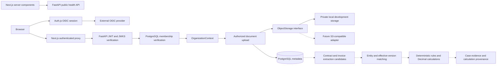

# Application architecture

## Current Phase 7 status

The foundation sections below are historical. Phase 4–6 financial/proof/recovery authority is implemented and merged. Phase 7 B–G adds protected runtime/storage/scanner/admission/operator/restore controls; H–I adds disposable browser/fault/resource qualification and SHA-pinned final CI evidence. See [validation](phase7-validation.md), [traceability](phase7-traceability.md), [execution decisions](phase7-implementation-decisions.md) and [runbook](phase7-deployment-runbook.md). Actual provider/cloud/staging/managed-restore/customer evidence remains pending; pilot NO-GO. No queue or financial-policy expansion is introduced.

## Deployment and module boundaries

One Next.js application, one FastAPI application, PostgreSQL, and a private object store. Backend modules are ordinary Python interfaces inside a single deployable application. There is no worker fleet, vector database, model provider, integration platform, or additional microservice.

Solid links represent current implementations or interface relationships; dotted links represent future orchestration. Health, verified identity, and authorized document APIs are connected to the frontend. Extraction, matching, leakage rules, and case orchestration remain future work.

## Tenancy and authentication

`User` is a global profile record. `UserIdentity` maps the unique configured issuer/subject pair to a user. Optional email is nonunique profile data, never an account-linking key. Concurrent first logins use a nested transaction and unique identity constraint to converge on one internal user without orphan records. `OrganizationMembership` keeps the existing unique organization/user pair with owner/admin/analyst/viewer roles. A database operator provisions membership for an already verified identity; no automatic organization enrollment or public membership mutation exists.

Stable NextAuth/Auth.js implements generic OIDC code/PKCE/state/nonce login and encrypted HttpOnly session cookies. API access tokens stay server-side; session JSON returns only public profile fields. The backend independently verifies signature, algorithm allowlist, issuer, audience, required expiry/issued-at/subject, and optional not-before using PyJWT and the configured/discovered JWKS. Token-provided `jku`/`x5u`, organization, and role claims never determine key sources or membership. Discovery checks the exact issuer and secure key URL, refuses redirects, and caches keys for five minutes with controlled rotation refresh. Provider outages fail closed. RS256 is the default; another asymmetric algorithm can be configured without a provider-specific code change. No passwords, credentials provider, production test-token issuer, or custom login protocol exists.

Runtime production configuration requires HTTPS. The optional test-verifier injection is an explicit factory argument accepted only with `environment=test`; setting an environment variable alone never installs a fixture. Test keys are generated in memory outside the deployed application. Local HTTP issuers are restricted to nonproduction loopback. Auth0 is an intended deployment choice rather than an implementation dependency.

Documents, contracts, versions, invoices, invoice lines, cases, evidence, and document/case associations carry non-null `organization_id` foreign keys. Composite foreign keys include organization IDs when linking business records. An invoice cannot reference another tenant's document or contract, and evidence cannot reference another tenant's case or source. These constraints are verified against real PostgreSQL.

This is referential isolation, not row-level authorization. No row-level security policy or automatic query filter is installed. The reusable identity and organization dependencies verify membership before constructing `OrganizationAccess`/`OrganizationContext`. All document reads and writes filter by this trusted organization. A URL organization ID is only a lookup selector: membership is established from the verified internal user, never frontend headers, form values, or token role claims. Next.js dynamically verifies each workspace render, and the API independently authorizes each request. Revoking membership takes effect on the next request even with the same valid token.

## Database entities

| Entity/table | Responsibilities |
| --- | --- |
| User / `users` | Optional nonunique email and display name |
| UserIdentity / `user_identities` | Unique issuer/subject identity linked to internal user |
| Organization / `organizations` | Tenant identity |
| OrganizationMembership / `organization_memberships` | Organization/user membership and basic role |
| Document / `documents` | Organization, filename, MIME type, size, object key, SHA-256, type, processing state, upload timestamp and nullable legacy uploader; new uploads always record the verified user |
| Contract / `contracts` | Logical agreement, counterparty, reference |
| ContractVersion / `contract_versions` | Original or amendment, source document, version number, effective interval, optional terms and agreed money |
| Invoice / `invoices` | Source document, optional matched contract, invoice number, supplier, dates, total, currency |
| InvoiceLineItem / `invoice_line_items` | Exact quantities and amounts, currency, description and ordering |
| LeakageCase / `leakage_cases` | Category, potential/validated/recovered exposure, confidence, priority, status, explanation, optional contract/invoice |
| LeakageEvidence / `leakage_evidence` | Source document, page, field, source text/location, calculation reference/expression/result |
| `leakage_case_documents` | Tenant-scoped many-to-many related document association |

Entities use UUIDs and timezone-aware `created_at`/`updated_at`. PostgreSQL stores timestamps as `TIMESTAMPTZ`; sessions use UTC. `updated_at` is advanced by SQLAlchemy updates; direct SQL updates must explicitly maintain it. Association links are immutable metadata with a creation timestamp. Deletions use restrictive foreign keys: retention, archival, and cascades need a separately specified policy.

## Financial safety

Python schemas require finite `Decimal` values, decimal strings, or integer input. Floats and booleans are rejected. JSON serializes money as strings. SQLAlchemy `ExactNumeric` stores PostgreSQL `NUMERIC(20,6)` and rejects non-Decimal bindings, excess fractional precision, and overflow instead of silently rounding. Confidence is `NUMERIC(5,4)` within 0–1. No JavaScript monetary calculation is implemented.

Amounts pair with uppercase three-letter ISO 4217-style codes. The format is checked; a complete currency registry and currency-specific settlement rounding policy are not implemented. Related invoice lines, invoice-linked cases, and case evidence must use their parent's currency through composite foreign keys. `sum_money` aggregates one currency using exact arithmetic and rejects mixed currencies and overflowing totals. There is no exchange-rate conversion, tax policy, discount interpretation, or settlement rounding.

Invoice values can be signed to preserve future credit adjustments. Leakage exposure and recovered amounts must be nonnegative. Unknown validated exposure and confidence remain null, not fabricated zeroes or scores.

## Documents and integrity

PostgreSQL holds metadata, never large file binaries. `ObjectStorage` defines streamed put/open/delete operations. `LocalObjectStorage` uses internal organization/document keys, streams a SHA-256 checksum and size, enforces a caller-specified size limit, rejects traversal and symlink escapes, publishes atomically, and refuses overwrites. Its root must be private and writable only by the application user; it is not an HTTP static directory.

Checksums are unique per organization; identical files across organizations have independent metadata and private objects. The service authorizes before multipart parsing, validates file size/extension/MIME/container, and delegates streamed checksum/storage writes to `ObjectStorage`. Generated object keys use organization/document UUIDs. Metadata commits after the object write; duplicate or transaction failure rolls back metadata and deletes the new object. A crash between object publication and commit can still leave an orphan, so a production reconciliation lifecycle is required. A failed compensation delete also needs an operational retry; errors are not silently counted as successful uploads.

PDF validation checks header/EOF, CSV validation checks UTF-8 and syntax across the entire file, and XLSX validation limits entries and uncompressed size, blocks traversal/encrypted members/macros, and uses defused XML for required workbook parts. These are format validation, not malware scanning or financial interpretation. Requests count received bytes regardless of Content-Length; the whole multipart cap is the file limit plus 1 MiB overhead. Files are returned only by membership-authorized attachment streams with nosniff, no-store, and sandbox headers. Browser uploads additionally enforce same Origin at the cookie-authenticated Next.js proxy. Viewer is read-only; owner/admin/analyst may upload. All new documents remain `pending`; `queued` is prepared but no processing job exists. S3, antivirus, OCR, and queue/retry execution are deferred.

## Contracts and provenance

Contract versions have positive version numbers, original/amendment kinds, and effective dates. Intervals are half-open: `effective_from <= date < effective_to`, with a null end meaning open-ended. Amendments can overlap because they may change only some terms. The model does not pretend every amendment is a fully consolidated contract snapshot. A future interpretation and matching policy must resolve active terms and conflicting amendments, preserve selected version IDs in case evidence, and version rule/calculation outputs before detection becomes authoritative.

Extraction interfaces return typed candidates and source references, not final financial truth. Matching, confidence, leakage rule evaluation, ingestion orchestration, and evidence generation are protocols with no invented algorithms. An eventual AI adapter may understand documents; deterministic code validates and calculates money. Calculation traces have named monetary inputs, an expression, a result, and a reference. Source references hold document, page, field, text, and location. Advanced PDF coordinates and highlighting are deferred.

Case statuses are `detected`, `needs_review`, `confirmed`, `false_positive`, `investigating`, and `resolved`. Priority and states are stored and validated, but there is no transition engine or workflow automation. Every implemented detection rule must eventually show what was detected, why, how the amount was calculated, and where evidence originated.

## Operational baseline

Configuration comes from environment variables and optional ignored development `.env` files. CORS uses an explicit origin list. Public errors omit exception details and invalid input bodies. Structured application logs include UTC time, level, event, request ID, route template, method, and HTTP status. They do not log tokens, connection strings, bodies, document text, or query parameters. Uvicorn access logging is disabled in documented commands to avoid a separate raw-URL log stream.

This foundation is ready for development, not deployment with customer financial data. Auth0 tenant connection/acceptance testing, operational monitoring, retention/backup policy, production secret management, API throttling, and managed object storage remain needed before production rollout. Access-token refresh is deferred; expired sessions require sign-in. No enterprise integrations, recovery automation, billing, SSO, advanced RBAC, or additional product modules are implemented.

## Phase 3 extraction boundary

See [Document Intelligence](document-intelligence.md). The new extraction_runs / extracted_fields tables retain tenant-safe candidate snapshots and evidence without duplicating or populating authoritative Contract, ContractVersion, Invoice or InvoiceLineItem models. Parsing, source-ID proposals, normalization, validation, execution and persistence are separate. Exact amounts retain NUMERIC(20,6); financial/legal interpretation remains a later phase.
