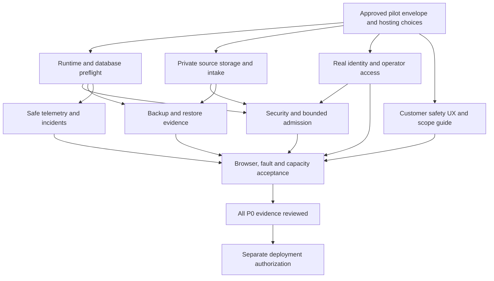

# Phase 7 — Pilot Readiness / Production Hardening

**Version:** 0.1 — audit and proposed implementation specification, for user review.
**Audited main:** `4a0d2520d4713355cec8b143f233aa61e5e655cc`. **Audit date:** 3 October 2026 UTC; verify again before any future implementation or launch.
**Execution status:** AUDIT / SPECIFICATION ONLY. Phase 7 implementation, commits, PRs and deployment are not authorized by this document or this task.
**Current external pilot verdict:** **NO-GO**. Application CI is green; blocking operational and staging evidence is absent or unvalidated.

This is a standalone audit artifact outside the repository. No repository file was changed. Approved Phase 4, Phase 5 and Phase 6 policy remains authoritative. Every future proposal below preserves existing financial calculations, evidence identity, approval roles and immutable history. A priority is a recommendation for pilot graduation, not authorization to execute it.

Evidence convention: E01–E32 identify exact current repository conditions in section 2. A claim of absence is limited to the inspected tracked tree, not undisclosed cloud resources. “Not evidenced” does not mean no external system could exist. CI evidence proves tested application behavior, not production configuration, customer input quality, legal suitability or deployed resilience.

## 1. Executive summary

The Contract-to-Invoice V1 pipeline is implemented through Recovery Ledger and merged. This audit does not propose another leakage engine. The correct next step is a narrow operationalization of the existing product: durable private sources, safe runtime configuration, real identity acceptance, recovery from failure, controlled customer intake, and a usable human review journey.

**Current overall status is NO-GO for a real external B2B pilot.** This is an evidence verdict, not a claim that the financial engine failed. Merge-head CI passes 672 backend tests on PostgreSQL 17.11 with zero skips and 100 frontend tests, including financial/proof/recovery concurrency and immutability controls. It does not demonstrate a running isolated staging/pilot environment, private cloud source storage, working real OIDC, usable customer browser flow, tested backups, restoration, alerts or support ownership.

The recommended first pilot is invite-by-operator, one explicitly enrolled company, manual protected uploads, supported deterministic layouts or explicit manual reviewed citations, and owner/admin final authority. No self-service signup/invitations, ERP/bank integration, OCR, financial-policy rewrite, queue, Kubernetes or certification program is required merely to start this pilot. Cross-tenant tests still require a separate synthetic tenant.

The main engineering gaps are production storage wiring, fail-closed production preflight/readiness, network/security/abuse controls and real staging/browser validation. The main operating gaps are provisioning/offboarding, backup/restore, incident and release procedures, data handling and honest onboarding/limitations. These can share components; the gate IDs below are evidence obligations, not 35 new subsystems.

Overall delivery complexity is **HIGH** because deployment, source preservation and database restoration must be proved together. The application changes themselves are mostly LOW/MEDIUM. There is no credible time estimate until pilot data, hosting/provider choices and operational recovery objectives are agreed.

## 2. Verified repository baseline

GitHub was queried before recommendations. `refs/heads/main` returned `4a0d2520d4713355cec8b143f233aa61e5e655cc`. PR [#11](https://github.com/yasthekiller007-lang/financial-leakage-ai/pull/11) is closed and `merged=true`, merged at `2026-10-03T23:06:09Z`, merge commit `4a0d2520d4713355cec8b143f233aa61e5e655cc`. Its parents are `15c7fc34d4d0092613dc2379f63d606594feebab` and final implementation `f16dc2a1e3acd439eab00ba0bc3eb94cd19a2bac`.

The merge tree is `c80ed3b1691ed3eb38f007e5f3ad04d59745b06a`. The clean existing local implementation checkout has the same tracked tree. It was inspected read-only; its branch/HEAD were not switched or changed. This proves the inspected tracked bytes match merged main without editing or fetching Git objects into the checkout. 213 tracked files were inventoried. No applicable AGENTS.md was found.

Merge-head [CI run 37160662485](https://github.com/yasthekiller007-lang/financial-leakage-ai/actions/runs/37160662485) completed successfully on `4a0d2520d4713355cec8b143f233aa61e5e655cc`. Backend job `111313235634` logs: PostgreSQL 17.11, 672 passed, no skipped-test summary, upgrade/check and disposable downgrade/re-upgrade/second check, extraction benchmark, bounded secret scan of 213 files with zero findings. Frontend job `111313235533`: 12 test files, 100 tests passed, ESLint/Prettier/TypeScript/Next build passed. These are current merge-head results; older Phase 4/5/6 checkpoint results remain historical.

Protected policy whole-file SHA-256 at the audited tree:

| File | SHA-256 |
| --- | --- |
| Phase 4 business specification | `1ee9eebf9ca81496f616c8bf55e64389341141762a501c3ec91fa654bb99fe09` |
| Phase 5 proof specification | `1dac7eb8377322552e12cc0c87b49baaa60123e53938209bb7e98699415c6e2a` |
| Phase 6 Recovery Ledger specification | `02ca1dfc256ef08f5fd8bf921b2f9a65ac185ae3df40e765439a40063d2c60c0` |

Phase 6 version 1.0, all PD6-01–PD6-37 Option A, R01–R10, invariants and worked examples are inherited policy, not Phase 7 decisions. No repository policy or code bytes changed during this audit.

### Current repository evidence index

The links below pin every observation to the audited commit. Symbol names are used where a file contains several related controls. Additional paths cited later are relative to this same commit, never a drifting branch.

| Evidence | Pinned repository file | Observed condition |
| --- | --- | --- |
| E01 | [.env.example](https://github.com/yasthekiller007-lang/financial-leakage-ai/blob/4a0d2520d4713355cec8b143f233aa61e5e655cc/.env.example) | Development-only values; 20 MiB uploads and explicit processing defaults; no production secret or deployment manifest. |
| E02 | [frontend/.env.example](https://github.com/yasthekiller007-lang/financial-leakage-ai/blob/4a0d2520d4713355cec8b143f233aa61e5e655cc/frontend/.env.example) | Server-only confidential OIDC values, application URL, backend URL and matching upload bound. |
| E03 | [compose.yaml](https://github.com/yasthekiller007-lang/financial-leakage-ai/blob/4a0d2520d4713355cec8b143f233aa61e5e655cc/compose.yaml) | Only PostgreSQL development service; 17.11, loopback port, durable local volume and track_commit_timestamp=on. No app deployment or backup service. |
| E04 | [.github/workflows/ci.yml](https://github.com/yasthekiller007-lang/financial-leakage-ai/blob/4a0d2520d4713355cec8b143f233aa61e5e655cc/.github/workflows/ci.yml) | Locked Python/npm installs, PostgreSQL 17.11, lint/format/tests/build, benchmark, bounded secret scan, upgrade/drift/down/up/drift. No browser/provider acceptance, dependency audit or deployment job. |
| E05 | [backend/app/core/config.py](https://github.com/yasthekiller007-lang/financial-leakage-ai/blob/4a0d2520d4713355cec8b143f233aa61e5e655cc/backend/app/core/config.py) | Settings.secure_identity_configuration checks HTTPS OIDC and explicit production CORS. Missing DB/OIDC is allowed; local storage remains the default. No production storage selection or comprehensive production preflight. |
| E06 | [backend/app/main.py](https://github.com/yasthekiller007-lang/financial-leakage-ai/blob/4a0d2520d4713355cec8b143f233aa61e5e655cc/backend/app/main.py) | create_app lifespan hardwires LocalObjectStorage; injected verifier restricted to test; body guards, CORS, safe route/request-ID logging; default FastAPI docs/OpenAPI remain enabled. |
| E07 | [backend/app/api/health.py](https://github.com/yasthekiller007-lang/financial-leakage-ai/blob/4a0d2520d4713355cec8b143f233aa61e5e655cc/backend/app/api/health.py) | health is process liveness. readiness queries organizations LIMIT 0: initial schema only; no head revision, storage or commit-tracking gate. |
| E08 | [backend/app/db/session.py](https://github.com/yasthekiller007-lang/financial-leakage-ai/blob/4a0d2520d4713355cec8b143f233aa61e5e655cc/backend/app/db/session.py) | Synchronous SQLAlchemy engine, pool_pre_ping, 5s default connect/statement timeout and UTC. Pool size/overflow and TLS policy are not explicitly configured. |
| E09 | [backend/app/auth/oidc.py](https://github.com/yasthekiller007-lang/financial-leakage-ai/blob/4a0d2520d4713355cec8b143f233aa61e5e655cc/backend/app/auth/oidc.py) | OIDCTokenVerifier validates configured asymmetric alg/kid, issuer/audience/exp/iat/sub; no token-directed JWKS. Discovery/JWKS caching and safe unavailable/invalid distinction. No per-request IdP account-status lookup. |
| E10 | [backend/app/auth/dependencies.py](https://github.com/yasthekiller007-lang/financial-leakage-ai/blob/4a0d2520d4713355cec8b143f233aa61e5e655cc/backend/app/auth/dependencies.py) | resolve_user uses issuer/subject without email linking; get_organization_access checks DB membership and hides tenants; viewer upload denied. |
| E11 | [backend/app/admin.py](https://github.com/yasthekiller007-lang/financial-leakage-ai/blob/4a0d2520d4713355cec8b143f233aa61e5e655cc/backend/app/admin.py) | Trusted operator CLI creates organizations and grants/updates existing verified identities. No revoke command, owner-transfer safeguard or durable attributed admin journal here. |
| E12 | [backend/app/modules/storage.py](https://github.com/yasthekiller007-lang/financial-leakage-ai/blob/4a0d2520d4713355cec8b143f233aa61e5e655cc/backend/app/modules/storage.py) | ObjectStorage put/open/delete protocol; only LocalObjectStorage adapter; UUID tenant/document/source keys, SHA-256/size, atomic no-overwrite hard link, private regular-file reads. |
| E13 | [backend/app/modules/upload_validation.py](https://github.com/yasthekiller007-lang/financial-leakage-ai/blob/4a0d2520d4713355cec8b143f233aa61e5e655cc/backend/app/modules/upload_validation.py) | safe_filename and validate_file enforce basename/MIME/extension, PDF header+EOF, complete UTF-8 CSV parse, XLSX member/size/type/XML/macro checks. No malware scanner or quarantine decision. |
| E14 | [backend/app/api/documents.py](https://github.com/yasthekiller007-lang/financial-leakage-ai/blob/4a0d2520d4713355cec8b143f233aa61e5e655cc/backend/app/api/documents.py) | upload_document authenticates before multipart; register_upload compensates DB failures/duplicates; downloads verify actual bytes then attachment/nosniff/no-store/sandbox. No ordinary delete endpoint. Upload bound is not an actor/tenant rate limit. |
| E15 | [backend/app/intelligence/parsing.py](https://github.com/yasthekiller007-lang/financial-leakage-ai/blob/4a0d2520d4713355cec8b143f233aa61e5e655cc/backend/app/intelligence/parsing.py) | Explicit text/CSV/XLSX parsing; formulas ignored, workbook external relations rejected, scanned/image warnings. No OCR or general semantic/visual table interpretation. |
| E16 | [backend/app/intelligence/execution.py](https://github.com/yasthekiller007-lang/financial-leakage-ai/blob/4a0d2520d4713355cec8b143f233aa61e5e655cc/backend/app/intelligence/execution.py) | execute hashes source and runs bounded Linux subprocess with sanitized environment/private temp files. worker.py uses CPU/address-space/output limits; not an OS security sandbox. |
| E17 | [backend/app/intelligence/service.py](https://github.com/yasthekiller007-lang/financial-leakage-ai/blob/4a0d2520d4713355cec8b143f233aa61e5e655cc/backend/app/intelligence/service.py) | Document-row claims, request identity, leases, immutable terminal snapshots and on-request interrupted recovery; no global worker admission or durable task queue. |
| E18 | [backend/app/financial/service.py](https://github.com/yasthekiller007-lang/financial-leakage-ai/blob/4a0d2520d4713355cec8b143f233aa61e5e655cc/backend/app/financial/service.py) | Stable ReviewedFinancialSource promotion, explicit manual/extracted evidence, append revisions, organization/fresh-membership locks, semantic evaluation dedup, stale checks and distinct immutable finding decisions. |
| E19 | [backend/app/financial/engine.py](https://github.com/yasthekiller007-lang/financial-leakage-ai/blob/4a0d2520d4713355cec8b143f233aa61e5e655cc/backend/app/financial/engine.py) | Deterministic supported fixed-unit, fixed-fee and unconditional percentage-discount profiles; unresolved comparison/rounding/tax/meaning blocked. Exact financial policy unchanged. |
| E20 | [backend/app/api/financial.py](https://github.com/yasthekiller007-lang/financial-leakage-ai/blob/4a0d2520d4713355cec8b143f233aa61e5e655cc/backend/app/api/financial.py) | Protected source/review/evaluation/decision/audit APIs. summary examines 1,001 newest evaluations, aggregates at most 1,000 and labels limited coverage; currency and non-overlap protected. |
| E21 | [backend/app/proof/assemble.py](https://github.com/yasthekiller007-lang/financial-leakage-ai/blob/4a0d2520d4713355cec8b143f233aa61e5e655cc/backend/app/proof/assemble.py) | C01–C10 bind immutable financial outputs, reviewed revisions/audits/packet/evidence and original bytes. canonical.py uses versioned domain-separated SHA-256; service.py separates overlays, redaction/disclosure/export/successor authority. |
| E22 | [backend/app/proof/budget.py](https://github.com/yasthekiller007-lang/financial-leakage-ai/blob/4a0d2520d4713355cec8b143f233aa61e5e655cc/backend/app/proof/budget.py) | verify_source streams actual bytes under cumulative work/read bounds, compares original SHA-256 and size, returns unavailable/mismatch instead of unverified content. |
| E23 | [backend/app/recovery/service.py](https://github.com/yasthekiller007-lang/financial-leakage-ai/blob/4a0d2520d4713355cec8b143f233aa61e5e655cc/backend/app/recovery/service.py) | One-case/economic-root proposals and recognition; enabled-guard checks, source re-verification, R01–R10, current authority, budgets, approvals, immutable negative corrections, no automatic upstream workflows. |
| E24 | [backend/app/recovery/publication.py](https://github.com/yasthekiller007-lang/financial-leakage-ai/blob/4a0d2520d4713355cec8b143f233aa61e5e655cc/backend/app/recovery/publication.py) | capture uses pg_xact_commit_timestamp(xmin) after financial commit; persists immutable actual K, never created_at. Missing provenance fails closed; reporting.py preserves as-known/economic precision and complete bounded totals. |
| E25 | [backend/migrations/versions/0006_recovery_ledger.py](https://github.com/yasthekiller007-lang/financial-leakage-ai/blob/4a0d2520d4713355cec8b143f233aa61e5e655cc/backend/migrations/versions/0006_recovery_ledger.py) | Six-migration chain ends at 0006. Composite FKs, recovery guards/audit/immutability/source protection; populated downgrade refused. 0003/0004/0005 similarly protect their history. No deployed least-privilege role setup. |
| E26 | [backend/app/core/logging.py](https://github.com/yasthekiller007-lang/financial-leakage-ai/blob/4a0d2520d4713355cec8b143f233aa61e5e655cc/backend/app/core/logging.py) | JsonFormatter allowlists operation metadata/opaque IDs; errors.py suppresses request bodies and exception strings; main logs route templates. No monitoring destination/alert setup in tree. |
| E27 | [frontend/src/lib/auth-config.ts](https://github.com/yasthekiller007-lang/financial-leakage-ai/blob/4a0d2520d4713355cec8b143f233aa61e5e655cc/frontend/src/lib/auth-config.ts) | Generic confidential OIDC PKCE/state/nonce; encrypted NextAuth JWT session maxAge=3600; access expiry requires re-sign-in, no refresh token. auth-server.ts strips incoming Authorization; no browser API tokens. |
| E28 | [frontend/src/lib/backend-proxy.ts](https://github.com/yasthekiller007-lang/financial-leakage-ai/blob/4a0d2520d4713355cec8b143f233aa61e5e655cc/frontend/src/lib/backend-proxy.ts) | Documents proxy validates UUIDs, Origin on cookie mutations, actual body byte count, 30s backend timeout, no-store safe headers; drops backend X-Request-ID. Intelligence/financial also omit some correlation headers; proof/recovery forward selected safe headers. |
| E29 | [frontend/src/lib/recovery-proxy.ts](https://github.com/yasthekiller007-lang/financial-leakage-ai/blob/4a0d2520d4713355cec8b143f233aa61e5e655cc/frontend/src/lib/recovery-proxy.ts) | Typed route whitelist, server credentials, JSON bound, same-origin writes, 30s timeout, no-store and safe header forwarding. Other phase proxies apply equivalent authentication/route boundaries. |
| E30 | [frontend/src/components/recovery-workspace.tsx](https://github.com/yasthekiller007-lang/financial-leakage-ai/blob/4a0d2520d4713355cec8b143f233aa61e5e655cc/frontend/src/components/recovery-workspace.tsx) | Explicit P/V/B/C/S/D/R/N, costs, blockers, roles and history pagination. Sources/instruments/evaluations selectors load first 100. financial-workspace/review-form and proof-workspace expose technical IDs and evidence paths. |
| E31 | [frontend/src/app/(workspace)/settings/page.tsx](https://github.com/yasthekiller007-lang/financial-leakage-ai/blob/4a0d2520d4713355cec8b143f233aa61e5e655cc/frontend/src/app/(workspace)/settings/page.tsx) | Stale Not configured/Coming soon membership copy despite implemented auth. sidebar.tsx says Development foundation. navigation includes implemented workspaces; no full browser test runner configured. |
| E32 | [docs/phase6-traceability.md](https://github.com/yasthekiller007-lang/financial-leakage-ai/blob/4a0d2520d4713355cec8b143f233aa61e5e655cc/docs/phase6-traceability.md) | Existing 37 PD /22 I /10 R /56 RW /50 AC mappings with concrete assertions/layers; architecture/validation reports explicitly exclude production load and real-provider acceptance. HANDOFF/README/Phase6 headers contain stale review/unmerged status. |

### Audit method and limits

Inspected root/setup/CI files; backend identity/config/DB/health/logging/storage/upload/parser/execution/services/APIs and migrations 0001–0006; frontend auth/proxies/navigation, document/financial/proof/recovery forms and page behavior; architecture/specification/validation/traceability documents; and corresponding security, arithmetic, concurrency, migration and UI/proxy tests. Existing green CI/logs were observed, not rerun unnecessarily. No live cloud inventory, secret, IdP tenant, customer document, production database, external browser session, malware scan or load/restore exercise was accessed. Recommendations distinguish those unknowns from missing repository implementation.

Classification used throughout: **I** implemented and automated-tested; **V** implemented, external/runtime validation missing; **F** missing functionality in tracked tree; **O** missing operating evidence/procedure; **C** customer-readiness work; **N** optional future improvement. A requirement may combine V/O without requiring new application code.

## 3. Current-state architecture summary

Next.js is the browser-facing confidential OIDC application and server proxy. FastAPI independently verifies API JWTs and reads current PostgreSQL membership. The API uses synchronous SQLAlchemy/psycopg transactions, composite tenant relationships and shared organization/membership fencing. Auth is present; the Settings placeholder is not evidence that it is absent.

Original documents are stored through ObjectStorage with SHA-256 and size. The configured adapter is always LocalObjectStorage. Explicit processing captures/hash-checks those bytes and invokes a bounded Linux subprocess without inherited application credentials. Phase 3 yields candidates, not authority. Phase 4 uses stable ReviewedFinancialSource identities and append-only reviewed revisions for governing packets, associations, terms and billing scopes. Approved deterministic evaluations have immutable identity/output and separate finding decisions.

Phase 5 assembles an immutable canonical proof core with C01–C10, deterministic fingerprints and distinct completeness/currentness/review/evidence overlays. Protected original and JSON downloads verify integrity. Disclosure is separate and recursive; it does not rewrite canonical evidence. Phase 6 adds stable case/instrument identities, reviewed proposals/evidence and append-only recognized events, allocations, costs and reversals. Actual commit provenance supports known-at reporting; economic dates remain separate. Legacy recovered_amount is not Recovery Ledger authority.

There is no live AI extraction, bank/ERP/GL integration, recovery export, autonomous recognition or external/vendor sharing. Current setup has a development PostgreSQL service and separate local app processes; the tracked tree does not define deployed pilot infrastructure. Evidence E03, E06, E12, E15–E25, E27–E32.

## 4. What is already pilot-ready

These are reusable **pilot-suitable application controls**, conditional on the runtime and staging gates. They are not a blanket declaration that an external pilot is ready.

| Existing control | Evidence and exercised validation | Reuse in Phase 7 |
| --- | --- | --- |
| Independent JWT and DB membership authorization; no email auto-link/grant | E09–E10; test_identity.py, test_documents.py, test_identity_concurrency.py | Configure a real provider and preserve server-only tokens. |
| Tenant-scoped access, protected sources and composite FKs | E14, E18, E25; tenant attacks across API and financial/proof/recovery tests | Validate the deployed boundary with two synthetic tenants. |
| Human promotion and immutable financial results | E18–E20; test_financial_api.py and test_financial_concurrency.py | Keep approval, knowledge cutoff, expected revisions and semantic dedup. |
| Canonical proof, C01–C10 and source capture | E21–E22; test_proof_canonical.py, test_proof_api.py, test_proof_concurrency.py | Retest against production adapter; no new export/PDF feature. |
| Isolated redacted disclosure with no metadata reintroduction | E21; recursive-redaction/export and hidden-actor tests in test_proof_api.py | Preserve existing tests; verify proxy/download response and logs in staging. |
| Recovery recognition, partial realization, reversal, basis and historical cutoffs | E23–E25; test_recovery_api.py, test_recovery_security.py, test_recovery_concurrency.py, test_recovery_worked_examples.py | Preserve all 56 examples and gates. |
| Exact money and separated metrics/unknowns | E19, E23, E30; test_money.py, test_recovery_values.py and UI tests | Display existing exact strings and currencies; never browser-recalculate truth. |
| Locked installs and broad full PostgreSQL regression | E04; merge-head CI | Retain every assertion; add operational validation around them. |

Source integrity and manual evidence meaning are different: verifying bytes proves the original was read, not that a manual quotation or legal interpretation is correct.

## 5. What exists but is not yet production-validated

OIDC validation, encrypted session cookies, membership fencing, private local sources, body/processing budgets, SQL timeouts, shared proof/recovery admission/quota, deterministic financial authority, audit triggers, migration safety and component/proxy UI tests all exist. Their external runtime behavior remains V: no real provider session/key-rotation/disabled-account acceptance, no actual HTTPS ingress/cookie/header capture, no production storage adapter conformance, no least-privilege DB credentials exercise, no restored managed database/source inventory, no measured representative pilot workload, and no real-browser full reviewer journey.

Provider MFA, encryption at rest, private network settings, backup/PITR availability, deployment secrets and on-call destinations are environment facts; they cannot be inferred from application tests or .env.example. Obtain evidence before claiming them. E01–E10, E12–E29, E32.

## 6. What is not pilot-ready

F gaps: a concrete production storage adapter and wiring; comprehensive production preflight/readiness; convenient controlled revoke/owner recovery operations; deployed dependency/security assessment; whole-workflow browser/provider acceptance. Some can be satisfied by a protected operator procedure rather than product UI.

O gaps: evidence of isolated staging/pilot, app/migration role separation, secrets rotation, safe release/rollback, encrypted backup/restore, source preservation/lifecycle, alert routing, incident owner, capacity measurements and coordinated offboarding. These are not automatically missing in undisclosed external systems, but no such evidence was supplied.

C gaps: supported-input qualification, governing packet/intake checklist, roles/financial terminology/training, manual citation limitations, visible pilot coverage, safe action confirmations and stale Settings copy. Full design-system or invitation UI is N, not a blocker by itself. E01–E08, E11–E17, E26–E32.

## 7. Critical P0 blockers

The objective matrix in section 42 defines each blocker and its exact graduation package in section 43. The decisive groups are:

1. **A safely deployable isolated staging/pilot runtime:** exact release/configuration, HTTPS/private dependencies, expected schema and PostgreSQL commit tracking, privilege separation and bounded admission.
2. **Durable private original bytes:** concrete adapter, non-overwrite, conditional cleanup, malware intake control, source/hash preservation and a demonstrated DB+object restore.
3. **Real identity and controlled access:** real-provider acceptance, role/revocation/tenant tests, verified provisioning and attributed operator/offboarding procedures.
4. **Observable recoverability:** scrubbed logs, dependency/financial failure alerts reaching an owner, incident procedures, backup evidence and explicit post-commit provenance failure handling.
5. **An honest, usable validated journey:** supported manual intake, unsupported-format handling, precise financial labels/coverage, real-browser happy/failure paths and customer limitations.

All are P0 because real external financial evidence or user authority would otherwise be exposed, irrecoverable, falsely represented or unsupported. Existing business logic is primarily a **validation obligation**, not a request to rebuild it. One unresolved blocking P0 yields NO-GO; a green unit/integration suite is insufficient.

## 8. P1 improvements

| ID / priority | Current → risk → recommended work | Validation |
| --- | --- | --- |
| P1-01 | E30 technical evidence paths/UUID selectors → reviewer friction → searchable human labels, advanced details collapsed, cross-workspace links retaining explicit commands | Reviewer task completion with no hidden approval/processing; exact IDs available in details. |
| P1-02 | E28 inconsistent request-ID forwarding → slower support correlation → normalize selected safe X-Request-ID/Retry-After propagation in documents/intelligence/financial | Proxy tests preserve valid IDs without reflecting token/header/body content. |
| P1-03 | E17 recovery-on-request only → abandoned runs less visible → interrupted-run operating view/alert and explicit retry guidance | Kill-process exercise preserves terminal snapshots and no automatic financial action. |
| P1-04 | E26 no aggregated operational dashboards → manual troubleshooting → a small latency/error/resource panel from safe metrics | Low-cardinality fields, tenant-ID access controls, no evidence content. |
| P1-05 | E04 dependencies/Actions versions present but update automation absent → patch drift → scheduled vulnerability review/update automation and SHA pinning of reviewed Actions | Advisory triage and full suite on proposed upgrades; one-time release scan is already P0. |
| P1-06 | E31 component testing only → browser differences → broaden browser/a11y coverage after launch beyond enrolled supported browsers | Safari/Firefox/Edge keyboard and form tests; unsupported browsers honestly described until tested. |
| P1-07 | E30 first-100 selection limits → sources inaccessible at larger pilot volume → bounded selector pagination/search | More than 100 fixtures accessible; no partial totals; P0 instead if enrolled dataset exceeds selector capacity. |
| P1-08 | E20 newest-1000 summary bound → interpretation risk at scale → improved coverage/filters and navigable assessment populations | Current limited label remains mandatory P0; no change to financial non-overlap/currency policy. |
| P1-09 | E27 sign-out clears app session only → SSO can reauthenticate → provider-specific RP logout convenience if customer requires it | Real-provider browser logout test; do not claim API JWT revocation. Required logout expectation is pending decision D7-02. |
| P1-10 | E12/24 restored source/capture procedure must exist → long-term robustness → periodic automated consistency/restore rehearsal and provenance backlog inspection | Authorized metadata capture only from actual PG provenance; no fabricated time or money. |

P1 priority can become P0 for the enrolled customer's actual requirements; record that dependency before launch rather than pretending every enterprise feature is necessary.

## 9. P2 improvements

| ID / priority | Current condition → future option | Boundary / evidence |
| --- | --- | --- |
| P2-01 | E11 operator onboarding → invitation/admin UI and richer membership management | Verified identity/current role checks remain mandatory; never public self-grants. |
| P2-02 | E17 synchronous adapter → durable queue only after measured need | Section 26; no Redis/Celery/Kafka adoption by default. |
| P2-03 | E03 one-pilot architecture → autoscaling/multi-region/high availability | Measured service objective and load justification required; no Kubernetes prerequisite. |
| P2-04 | E31 basic responsive forms → broader mobile/design-system redesign | Target actual customer devices; safety-critical keyboard/form correctness is P0. |
| P2-05 | E04 locked install → richer SBOM/artifact signing/provenance attestations | Useful assurance, not a claim of SOC2/ISO certification. |
| P2-06 | E15 explicit layouts → separately approved OCR/specialized document intelligence | New capability/policy approval needed; never silently broaden Phase3 authority. |
| P2-07 | E32 internal/manual product → later integration/enterprise workflow products | Outside Phase7; no dormant alternate writable financial authority. |

## 10. Explicit deferred scope

Preserve all deferred Phase 4–6 profiles and boundaries. No new leakage family, duplicate/payment or shadow-spend engine; no OCR or broad free-form/multilingual AI interpretation; no ERP/bank connectors, GL/accounting journals or recovery exports; no vendor communications or automatic outreach; no FX, bundled multi-finding settlements, quantified avoided/annualized/forecast savings, gain-share billing, Firewall, Leakage DNA, network intelligence, payment blocking or autonomous financial approval/recovery. No legal/tax/fraud determination or certification claim. No production deployment in this task or in the implementation plan without a later explicit deployment approval.

Current source-byte verification, C01–C10, exact Decimal policy, P/V/B/C/S/R/N separation and immutable history are constraints, not candidates for simplification. E18–E25, E32.

## 11. Deployment architecture recommendation

**Proposed P0 minimum:** one regional Linux application deployment with a browser-facing Next.js service and private FastAPI service, PostgreSQL 17 managed where its required features are demonstrated, and a private object store. A basic managed load balancer/reverse proxy is sufficient. Staging and pilot have separate DBs, buckets, credentials and OIDC confidential clients/audiences as appropriate. Test/synthetic data never shares production customer storage. No additional orchestrator is justified by E03/E16/E17.

Use the current synchronous execution model initially. Choose Linux because worker.py imports resource and enforces RLIMITs. Run as non-root with private writable temporary directories, bounded CPU/RAM/disk/process count and constrained parser egress; sanitized environment alone is not a security sandbox. Preserve original bytes outside temporary processing paths. The Next process receives confidential OIDC/session secrets and backend address; the API receives DB/object/issuer/audience configuration. A separate migration job receives DDL credentials; the app must not.

Production preflight must fail explicitly when DB/OIDC/storage/HTTPS/CORS/secret configuration is incomplete. This corrects E05–E07 without adding another authentication architecture. Establish readiness before admitting traffic and stop admission/drain in-flight bounded operations before replacing a process. Configure ingress/proxy request/idle timeouts from measured processing/upload durations; the existing 30s proof/recovery proxy and 150s extraction proxy are facts, not universal safe release timeouts.

A future release manifest records exact code SHA, immutable build identity, schema 0006 or approved successor, dependency locks, operational profiles and redacted environment identity. Single-instance pilot runtime is acceptable if restore/downtime objectives are explicit and tested; object storage still avoids dependence on replaceable application disks. Hosting/provider/region/data residency choices are D7-01, pending approval. No specific cloud has been selected or priced.

## 12. Database production requirements

E03/E04 prove PostgreSQL 17.11 in CI; E08 uses synchronous transactions and pool pre-ping. **P0:** retain PostgreSQL 17 compatibility and demonstrate the selected managed service permits track_commit_timestamp=on at server startup, pg_xact_commit_timestamp, required PL/pgSQL/triggers/advisory locks and six migrations. Do not choose a service merely from a “Postgres compatible” label. Verify configuration on restored/failover nodes as well as the initial primary.

PostgreSQL documents commit tracking as a startup setting, off by default. Commit functions only describe transactions committed while tracking was enabled. Phase6 capture must retain actual provenance and fail closed if missing; a logical restore does not recreate original row xmin/commit history. Prefer a proven physical/PITR recovery path plus preserved RecoveryPublication rows; exercise the chosen service's actual restore behavior. Never reconstruct historical K from created_at or restore time. See section 30 and sources S1/S2.

Use separate least-privilege app, migration and operator identities. The app must not own schema/tables, disable triggers, SET session_replication_role to bypass them, truncate financial tables or change roles/memberships. Grant only operations actually used by resolve_user, phase services and trusted audit triggers. Test under this role because CI uses a disposable privileged database identity; grants cannot be assumed from E25. Operators provision/revoke under attribution; DDL access is exceptional and separately audited. Restrict backup roles and restore destinations.

DB TLS must verify host/certificate across nonlocal links; private networking and at-rest encryption are selected-provider facts requiring configuration evidence. Do not print DSNs. Rotate credentials by controlled overlapping access/restart and prove old credentials fail. Use explicit pool_size/max_overflow/pool_timeout and calculate **processes × per-process pool maximum + migration/monitoring/reserve connections** within selected DB capacity. E08 currently relies on defaults; no extra pooler is required unless measured need. Any transaction-pooling product must preserve transaction-scoped advisory locks, settings and commit capture; test before using it.

Retain UTC sessions, per-operation statement/lock budgets and exact transactions. Measure organization-lock contention/long transactions, rejected admission and DB disk/connection/WAL pressure. Backups, PITR if needed for the chosen RPO, restore and failover rehearsal are P0 evidence. Empty CI downgrade success is not a rollback plan for a populated customer DB: 0003–0006 refuse data loss. Forward-compatible hotfix or restore under an approved incident plan replaces destructive downgrade. E08, E18, E23–E25.

## 13. Private object-storage architecture

**A concrete production adapter is recommended P0**, because create_app hardwires development storage and sources drive historical financial/proof/recovery authority (E06/E12/E22–E24). Durable storage is required even for one company; a replaceable app filesystem would lose evidence on redeploy/host loss and cannot safely support independent instances. A specially operated persistent-volume alternative is not automatically invalid, but requires equally demonstrated durability/isolation/backup/restore and a reviewed exception; it is not the default plan.

Keep ObjectStorage provider-agnostic. Implement one S3-compatible adapter only after validating the selected provider's semantics. Preserve put/open/delete interface or minimally extend technical outcome types without changing evidence identity. Use the exact generated tenant/document/source key; no customer filename in object keys, no cross-tenant arbitrary path from requests. Stream bounded exact originals, compute SHA-256 and byte size locally, publish without overwrite, and return those exact values. Use conditional creation supported by the provider; S3's If-None-Match supports no-overwrite publication (S3). ETag is not the product SHA-256 and is not always a whole-object MD5 (S4).

Private bucket/container, public-access blocking, TLS, encryption, explicit scoped workload IAM and short-lived identity are P0. No public ACL, unauthenticated listing or web hosting. Keep authenticated API downloads; signed URLs/CDN are not needed. SDK redirects/retries/timeouts must remain bounded by the operation budget; interrupted uploads cannot expose partial originals. Test object missing/denied/truncated/changed, concurrent same-key puts, metadata/size mismatch and SDK failures against the real selected service.

Versioning is recommended to support accidental deletion/overwrite recovery, subject to provider confirmation and lifecycle policy. It does not by itself guarantee backup or legal retention. The application must read the original intended version or detect mismatch; never quietly accept “latest corrected” bytes for old evidence. No lifecycle expiry of referenced authority without an explicitly approved future policy. Do not invent universal object-lock retention, permanent preservation or legal holds.

Compensating delete after a failed new upload must target only that new, unreferenced object/version. It must never delete a pre-existing key or protected evidence. Privileged deletion remains an audited exceptional operation. Existing DB source guards cannot police out-of-band object administrators. Separate restore/administrative IAM; validate restored originals against the recorded hashes before readiness. Storage health uses a bounded dedicated canary prefix rather than modifying authoritative source keys. Orphan inventory/cleanup is P1 unless failed uploads exhaust the actual pilot capacity; no automatic deletion of referenced evidence.

## 14. Authentication / membership / operator model

E09/E27 already implement genuine generic OIDC. Reuse it with one supported real provider (Auth0 is documented intent, not a configured deployment fact). Configure issuer identically, API audience separate from client ID, declared asymmetric algorithms/JWKS/discovery, exact HTTPS callback /api/auth/callback/oidc and allowed logout URL. Validate key rotation, discovery outage and no token-controlled key URLs. Keep API credentials in encrypted HttpOnly cookies and server proxy only; do not add test-token minting or frontend secrets.

**P0 controlled operator provisioning is sufficient** for the first pilot; invitation/admin UI is P2. A new identity must complete verified sign-in before the operator grants tenant access. Use issuer/subject and independently confirm the customer-approved roster/role; names or email domains do not confer authority. Analysts prepare and owner/admin finalize; viewers read. No silent role creation from IdP claims.

E11 provides create/grant/update but no revoke or explicit owner-transfer safety. Add a protected attributed revoke/role-transfer command, or a reviewed transaction/runbook with equivalent fencing before launch. Preserve organization lock/membership order so an in-flight financial approval either completes under the old valid fence or observes revocation; it must not mix authority. Verify at least one reachable authorized customer owner/admin before removing the final owner; emergency recovery uses a named operator, verified request, recorded reason and audit, not ordinary-user escalation.

App sign-out currently clears the application session; it does not implement provider RP logout. Token validation is offline JWT verification, so disabling an IdP account alone cannot be assumed to invalidate already-issued API tokens immediately. **P0 offboarding revokes local memberships and provider access**, then tests the same old token. Document this distinction and re-sign-in expiry; optional SSO logout semantics are D7-02. Provider-side MFA for privileged customer/operator identities should be configured and evidenced at launch; the app does not itself enforce provider MFA. No refresh-token subsystem is needed for the pilot. E09–E11, E27.

## 15. Security hardening requirements

| Priority / threat | Current condition | Proposed minimum and validation |
| --- | --- | --- |
| P0 unauthorized tenant/financial authority | E10/E18/E23/E25 server and DB controls exist | Retain all tenant/role/stale/concurrency tests and exercise deployed proxies/API as two tenants/four roles; no authority solely in UI. |
| P0 source theft/network interception | E03 loopback is local-only; external ingress absent | HTTPS, private API/DB/store access, certificate checks and trusted proxy list; external scan cannot reach internal ports. |
| P0 credential exposure/privilege bypass | E05/E11/E25 no complete production privilege setup | Production config/secret rotation, nonowner DB app role, protected operator/DDL paths; prove trigger-disable and direct forged audit denied. |
| P0 clickjacking/content sniffing/cross-site mutation | E06 CORS and E28/E29 Origin controls exist; E31 Next config has no site-wide header policy | Validate secure HttpOnly/SameSite cookies, same-origin writes; frame-ancestors/X-Frame-Options, nosniff, Referrer-Policy and HTTPS/HSTS appropriate to owned domain. CSP must preserve OIDC/Next behavior; broader strict script CSP can remain P1 after staged validation. |
| P0 denial of service by authorized/replayed uploads or processors | E14 bytes bounded; E16 worker bounded but E17 lacks global processing admission | Shared ingress/application upload and processing concurrency/rate protection with measured thresholds; cannot multiply by workers or trust spoofed forwarded IP. Do not alter existing financial amounts/approved profiles. |
| P0 known exploitable dependency/runtime vulnerability | E04 locked installs and secret scan, no dependency audit | Scan exact resolved Python/npm/runtime/image versions, triage reachability and fix blocking exposure or prove mitigation; section 17/41. |
| P0 misleading history after failures | E22–E25 immutability and provenance already present | Staging tamper/fault/retry/restore exercises, explicit stale/unavailable states and same semantic identity. No automatic financial repair. |

CORS is not authorization. Backend accepts bearer tokens, while Next cookie mutations require Origin; test both boundaries. FastAPI defaults expose docs/OpenAPI unless production ingress/app configuration restricts them. Restrict unnecessary public surfaces and arbitrary Host/forwarded headers; keep internal health available to monitors without secrets. A public schema alone is not a universal security failure, but public bypass of the intended private API is P0. Security headers on document downloads already exist; do not falsely report them absent.

Use S6 (OWASP header guidance) as technical support, not a mandatory enterprise checklist. No WAF, separate service mesh, SIEM or Kubernetes is justified unless the actual threat/load exceeds simpler controls.

## 16. Data/privacy handling model

**P0 data-handling agreement and runtime controls:** contracts/pricing, invoices, personal contacts, banking/remittance details and manual quotations may be sensitive. Record customer purpose, authorized operator access, approved provider/region/subprocessors, access roster and customer support boundaries before intake. Obtain applicable privacy notice/DPA/commercial review through the responsible parties where needed; technical controls are not legal certification. D7-01/D7-04 remain pending.

TLS, storage/DB encryption configuration, workload secrets and restricted backups/logs are evidenced separately. Ordinary viewers cannot change authority but can read authorized evidence; confirm the customer understands this role. Restrict operator originals/DB access to an attributed, approved purpose; no real data in developer laptops, demo tenants, CI fixtures, browser traces/screenshots or error tracking. Use synthetic data for acceptance and scrub any later necessary support sample.

Preserve referenced evidence under existing delete safeguards. No universal retention duration or automatic legal erasure is specified. User offboarding revokes membership and IdP access; tenant offboarding also stops traffic/work and access, inventories originals/history/backups and routes deletion/legal hold requests to explicit later policy. Revocation is not deletion; deletion from live storage is not backup erasure. Do not promise permanent retention, regulatory compliance, accounting/tax suitability or instantaneous purging. E10–E14, E22–E26, E32.

## 17. Upload-security requirements

Current safeguards are substantive: authentication before parsing, actual byte counts, strict basename/MIME/extensions, complete CSV validation, ZIP member/count/expanded-size bounds, macro rejection and defused XML (E13–E14); processing ignores formulas and rejects unsafe workbook relationships (E15). PDF upload validation is primarily header/EOF; full parsing occurs later. Structural validity **is not malware scanning**. Attachment/nosniff/sandbox protect serving but do not make a file safe when downloaded into customer desktop software. Linux resource limits do not prevent a parser escape with process user filesystem/network access.

**P0 threat outcome:** untrusted supplier/customer originals must not be parsed or redistributed as ordinary available sources without a defined malware intake control. Recommended implementation is private quarantine plus a bounded scanner verdict bound to exact SHA-256/size/scanner/version, fail closed on unavailable/unknown/rejected verdict, then explicit release for normal processing/download. Preserve original bytes; no content-disarm rewrite of the canonical source. Scanner state is an operational availability overlay, never financial approval or C01–C10 completeness. No malware-clean claim guarantees absence of threats.

For a tightly controlled operator-only intake, an independently recorded preflight scan of exact originals in an isolated trusted environment can satisfy the same P0 outcome if customer direct upload/processing cannot bypass it. This is an alternative requiring approval D7-03; it is not a silent waiver. Automated scan/quarantine is P0 for unrestricted enrolled uploaders; a richer async scanning UI, multiple engines, CDR and continuous rescan automation are P1/P2 unless a measured threat requires them. Do not send confidential originals to public malware-analysis services.

Validate safe scanner test material, malformed PDFs, active-content samples, renamed types, traversal/Unicode filenames, sparse/duplicate ZIP entries, dishonest expanded sizes, macros, encrypted archives/PDFs, XML entities, formulas/cached values, external relations, chunked oversized uploads, disk fill, scanner timeout and repeated valid-size abuse. Prove no processing/download during unknown/quarantine, no source bytes rewritten, and original hashes remain identical after release. Protect the upload-time parser path too, not only the later RLIMIT worker. E13–E17; S5 supports layered validation/scanning but the P0 classification here follows the actual download/parser exposure.

## 18. Observability architecture

E26 already provides structured logs and UUID request IDs. FinancialAudit is a protected business history, not a substitute for service monitoring. Request logs use route templates rather than raw resource URLs; extraction logs include opaque tenant/document/run IDs and safe duration/version/status; exceptions omit input/trace text. Preserve these choices.

**P0:** collect safe application/proxy/DB/storage/identity health events into an access-controlled destination, with a tested alert route to a named operator and deputy. Minimum signals: readiness failure; API auth/5xx rate; source read/scan/integrity failure; parser timeout/interruption; proof integrity failure; recovery guard/provenance failure; DB connections/disk/lock waits; failed backups/restores; ingress upload/admission rejection. Use simple provider monitoring and an owner notification channel; an elaborate dashboard/error SaaS is not necessary. If used, error tracking must disable body/header/cookie/full-stack local-value capture and be tested with sentinel sensitive values.

| Allowed operational fields | Forbidden fields |
| --- | --- |
| Generated request ID, route template, method, status, duration, stable reason code, operation/profile/parser version, bounded byte count | Access/refresh/ID tokens, cookies, Authorization, secrets, DSNs, client secrets, raw OIDC claims/profile/email, raw query strings/bodies, original filenames, document bytes/quotations, invoices/contract terms, account/bank numbers, full financial evidence or amounts |
| Opaque organization/document/evaluation/finding/run IDs only in restricted diagnostic logs when needed | IDs in public logs, high-cardinality metric labels or ordinary alert messages; IDs are correlatable customer metadata, not anonymous data |

Metrics use operation/outcome/status class and bounded reason categories, not tenant/document/person IDs. Alert contents carry environment/service/severity/request ID and a restricted diagnostic link, no evidence or money. Log access/retention/region and deletion handling require an operating decision; do not invent a universal duration (D7-04). Audit access is separately role-controlled. Verify platform access/error logs, framework/SDK logs and browser recordings too; application allowlisting alone cannot scrub the hosting platform. P1 normalize correlation headers across phase proxies (E28); P0 failure reports still need a safe support correlation path.

## 19. Reliability / disaster-recovery design

Use deterministic fail-closed outcomes; do not create silent financial corrections. Existing idempotency, source verification and immutable corrections are reused (E14, E17–E25).

| Failure | Safe behavior / retry category | Pilot validation |
| --- | --- | --- |
| DB unavailable/lock timeout | No guessed history or partially committed authority; retry same semantic request after recovery | Inject outage/lock contention; inspect event/audit counts and current predecessor. |
| Storage missing/denied/corrupt | Unavailable/integrity blocker; no unverified download or positive recognition | Remove/change/deny synthetic source; restore exact bytes; history stays immutable. |
| OIDC discovery/JWKS outage | New uncached verification may 503; cached valid tokens may continue within existing policy | Test cache expiry/rotation/outage and no fallback test identity. |
| Partial upload/DB commit failure | No partial published source/row; compensation limited to new unreferenced object | Interrupt both phases and validate DB+object inventory; orphan cleanup is not evidence deletion. |
| Worker timeout/crash | Bounded kill, safe failed/interrupted attempt; explicit reprocess with new version | Kill before/after claim and lease expiry; late worker cannot overwrite terminal result. |
| Browser/proxy response lost after commit | State may already exist; reload/retry with same request identity | Exactly one event/evaluation/proof; no duplicate charge/authority. |
| Financial audit insertion failure | Entire authority transaction rolls back | Inject trigger failure under deployed DB role. |
| Recovery publication failure after commit | Already committed financial event remains; unresolved actual K is explicit; metadata retry only | Do not show “money failed/rolled back”; capture exact PG provenance after restart. |
| Concurrent approval/credit/reversal | Consistent fence/budget; loser conflicts/retries; never truncate amount | Existing independent-session races plus deployed multi-process test. |
| Failed migration/deploy | Stop traffic admission, preserve history, retain old compatible release or explicit forward repair/restore | Rehearse incompatibility and populated downgrade refusal. |

Retryable: dependency/transient timeout/admission failure where no definitive commit is claimed; exact idempotent retry or metadata capture as appropriate. Non-retryable without corrective action: malformed/unsupported input, integrity mismatch, invalid role/tenant, conflicting key/body, stale predecessor, incompatible economic basis or missing manual approval. Reload/review explicitly rather than auto-changing values.

**P0 DR plan:** encrypted DB backups and original-object preservation/restore under separated permissions, tested together with actual commit provenance, schema/guards and reporting digests. Define internal RPO/RTO from customer data replaceability and operator availability; no numerical target is measured or approved yet (D7-05). P1 scheduled repeated drills; multi-region automatic failover is P2 unless agreed objectives justify it. No contractual SLA is created here.

## 20. Release/deployment process

Future implementation, if separately authorized, must use development → complete exact-head CI → isolated staging → real-provider/browser/failure/restore smoke → **explicit deployment approval** → controlled pilot. No deployment occurs in this task. E04 has CI but no deployment workflow; E25 prohibits unsafe populated downgrade.

P0 release procedure: pin exact SHA and build/lockfile identity; retain redacted configuration/profile/schema manifest and deployer/reviewer/time; verify secret/environment separation; execute migration once under migration role before only schema-compatible app traffic; block on readiness; then smoke the reviewer journey and failure states. For any future irreversible migration, document compatibility window, tested upgrade and rollback/restore plan before rollout. A green empty downgrade check cannot authorize production data deletion.

Roll back application only if the prior binary understands the actual schema and preserved records. Prefer roll-forward fix where necessary; restore requires explicit incident approval and verified loss/reconciliation boundaries. Never drop guards or edit monetary history to make an old release run. Hotfixes retain urgent scope review, exact-head checks and minimum staging negatives; no “temporary” financial bypass. Tag/release labeling is useful but the commit identity is primary; release audit can be an access-controlled change record without a new product table.

Provider secrets are environment-scoped, restricted to job runtime and omitted from logs/artifacts. Pin/review deploy tooling and Actions before production secrets are introduced. Checkpoint history is not launch evidence until the complete final SHA and runtime configuration pass the matrix.

## 21. UX/client workflow improvements

The actual browser pipeline exists across Documents, Leakage cases/Overview, proof detail and Recovery Ledger (E30/E31). Keep it; do not redesign the product as a single autonomous “recover money” button.

| Priority | Actual condition → risk | Required improvement / validation |
| --- | --- | --- |
| P0 safety | financial-workspace.tsx action() always says Review saved; showDetail() also calls it → a read can be perceived as saved review | Action-specific read/save/evaluate/confirm notices; reading never reports approval or financial mutation. Browser assertion checks both data and notice. |
| P0 safety | Many currentness/proof/readiness axes and technical labels; recovery-proposal-form sets completed/readiness fields for an explicitly reviewed submission → reviewers can miss meaning | Show what is proposed versus approved, all material values/method/basis, original source and manual attestation before final approval; server gates unchanged. Do not auto-confirm evidence from a checkbox alone. |
| P0 safety | Existing exact null/zero/currency and limited coverage labels → formatter/redesign could erase meaning | Preserve decimal strings, distinct Unknown/Not recorded/Unresolved/known 0, currency/tax basis and complete-vs-page coverage. No JS float truth/FX/net savings. |
| P0 safety | Stale responses and disabled authority may have old detail still visible after a failed reload | Clear or visibly mark stale/unavailable detail; no success message after denied/failed mutation; reload current expected predecessor before retry. |
| P0 safety | Revocation/dismissal/closure/reversal are explicit but complex | Describe financial consequence and immutable history, require reason and deliberate confirmation for final/destructive authority; keyboard accessible errors/focus. |
| P1 | Forms expose IDs, raw keys/pointers, quotations and first-100 selectors | Human labels/search, source lookup and guided review/packet/association steps with advanced technical section; retain exact evidence mapping and explicit workflow links. |
| P1 | Settings/sidebar stale development status despite OIDC and memberships | Replace misleading status with actual read-only account/role/provisioning guidance; full admin UI stays P2. |

Initial loading, empty, failed, role-restricted, stale and blocked states must be distinguishable. Existing documents/proof/recovery tests already cover many of these; real browser verification is missing. P/V/B/C/S/D/R/N remain accessible full-word definitions: potential discrepancy; internally confirmed amount; approved pursuit ceiling; actual claim; acknowledged/disputed principal; verified realized recovery; net bank cash. None is a synonym for guaranteed savings.

Use readable currency-first values with unrounded exact details, semantic tables/headings/labels, predictable tab/focus behavior, announced errors/status and local/economic/known-at date labels. Pilot task testing must show a reviewer can complete the required happy path and identify a missing approval/source without inspecting implementation code. Desktop/laptop first; supported browsers depend on D7-06, not an untested universal claim.

## 22. First-pilot data intake workflow

**P0 procedure, no integrations:**

1. A named customer owner and operator agree pilot entities/currencies/date window, supported rule profiles, complete contract packet and reviewer roster. Record the scope as customer instructions, not inferred legal applicability.
2. Customer inventories master contracts plus amendments, schedules, exhibits, referenced rate cards and invoice exports. Name source files descriptively (customer reference/type/economic date/version); do not put bank/account numbers in filenames. Original names remain display metadata, never storage keys or financial matching authority.
3. Apply the approved malware intake route, private upload and type classification. Originals/hash/size remain protected. Purchase orders are corroborating references where relevant, not automatic contract authority. Credit notes, settlement/bank/remittance/legal documents are manually reviewed protected evidence; secondary types are not new extraction engines.
4. Explicitly process only supported inputs. Compare candidates to the original, resolve unknown/ignored/formula/scanned/layout warnings, then prepare source-backed terms, billing scopes and references. Manual quotations remain attributed assertions. Document processing status does not approve a contract/invoice.
5. Owner/admin approves the governing packet and explicit contract/invoice association, effective-date/precedence/scope/rounding/tax/currency meanings. Missing exhibits or contradicting amendments block the affected assessment; never guess completeness.
6. Explicit evaluation yields immutable P/blocked/no-overcharge/undercharge. Owner/admin confirmation is separate. Explicit proof generation validates C01–C10; optional human proof review/export is not an added Recovery readiness requirement.
7. Investigate a case, then explicit reviewed counterparty/readiness/instrument/economic evidence and owner/admin recognition. A real direct refund needs no fabricated claim/acknowledgment. Applied credits and liability reductions require their own completed evidence. Issuance alone is pending stock.
8. Repeat identical upload returns tenant duplicate conflict; it does not mean duplicate-invoice leakage. Replacement evidence is a new original and explicit reviewed revision/evaluation/proof lineage as required, never file overwrite. Changed money uses existing revision/correction workflows.

Customer responsibilities: provide complete authentic packet, explain export semantics/economic entity/basis, nominate reviewers, and verify source meaning. Operator responsibilities: safe intake/access, format qualification/support and integrity incidents. Analyst prepares; owner/admin exercises final authority. Missing data remains a blocker with a requested document list, not a zero result. E10–E25, E30.

## 23. Unsupported-document workflow

Recommended first-pilot choice is **controlled rejection/flagging plus explicit manual review using existing Phase4 citation semantics**, not OCR. This is a delivery recommendation within current functionality, not permission to broaden extraction.

| Input | Current behavior / limitation | Pilot response |
| --- | --- | --- |
| Image/scanned PDF | needs_ocr heuristic; no OCR; text-rich images warn | Tell customer OCR is unsupported; request a searchable original or faithful approved labeled export. A competent reviewer may manually cite/read the original through existing explicit workflow; never machine-infer missing values. |
| Vector scan/deceptive text layer | Scan detection not comprehensive | Manual source-quality qualification even when status is processed; reject if a reliable human citation cannot establish meaning. |
| Free-form/unlabeled/complex visual tables | ExplicitLabelProvider cannot interpret general legal/visual layout | Supported template/export or manual prepared facts with locations/support mappings; unknowns stay null. |
| Missing schedules/amendment conflict | Candidates do not resolve legal precedence | Obtain missing packet or explicit authorized meaning under Phase4; block affected scope until resolved. |
| Malformed/encrypted PDF/archive | Safe failure/unsupported | Request corrected original through new upload; do not disable parser/security checks. |
| Formula spreadsheet/locale/date serial | Formula cached values ignored; uncertain meaning unknown | Obtain literal supported values with documented meaning/source; do not calculate spreadsheet code. |
| Unsupported layout/supplier variation/multilingual values | Review warnings/unresolved | Preflight representative synthetic/redacted layout and manual scope; no autonomous legal/extraction interpretation. |
| Over-limit large spreadsheet/PDF | Explicit processing limit | Ask for evidenced complete scope partition/export; each assessed population names coverage. Never silently truncate a contract, invoice, proof or total. |

Preserve original evidence and relation to any re-export. Operator-transformed files are not represented as supplier originals. If manual review cannot establish compliant approved facts/C01–C10, the case remains blocked and may be outside enrolled scope. Bounded OCR remains P2 with a separate product approval, not a Phase7 launch prerequisite. E13/E15–E19, docs/document-intelligence.md.

## 24. Demo/synthetic dataset design

Proposed fictional tenant: **Synthetic Pilot Workshop**, visibly labeled fabricated training data in every demo entry point. Synthetic vendor/customer legal references use DEMO namespaces; no real company, account, invoice, person or bank detail. Seed only through explicit existing authorized workflows, preserving audit actors, original hashes, dates and approvals. Do not create seed data in this audit.

All following amounts are USD tax-exclusive principal with explicit quantity, date, rounding, scope and counterparty evidence; quantum 0.01 is a reviewed example input, not a new default. Each demonstration has complete original/packet citations or an intentional named blocker. Credit roots are new recovery evidence not already netted into Phase4 billed amounts.

| Scenario | Exact synthetic setup / expected presentation |
| --- | --- |
| DEMO-01 clean | 100 units × 10.00 = 1,000.00 contractual and posted. No overcharge, zero discrepancy; no monetary finding identity for explanatory package. |
| DEMO-02 fixed unit price | 100 × contracted 10.00 versus billed 12.00: expected 1,000.00, actual 1,200.00, P 200.00. |
| DEMO-03 fixed cycle fee | Complete contractual cycle fee 1,000.00, posted 1,100.00: P 100.00; no proration inference. |
| DEMO-04 unconditional discount | Evidenced eligible base 1,000.00, unconditional 10%: expected 900.00; posted 950.00 with 50.00 discount: P 50.00. No combined extra finding for the same members. |
| DEMO-05 blocked | Missing amendment or unknown tax basis: amount null, explicit blocker and requested evidence. |
| DEMO-06 confirmed | DEMO-02 receives explicit current owner/admin finding confirmation: V 200.00; not cash. |
| DEMO-07 COMPLETE proof | DEMO-02 proof has all C01–C10 and verified originals. Human review/export remains separate; no automatic ledger action. |
| DEMO-08 claim | Reviewed B 150.00 ≤ V 200.00, actual evidenced actioned C 150.00. Vendor acknowledgment S 100.00 may be recorded separately; neither creates R. |
| DEMO-09 partial cash | Completed cash instrument principal/gross/N 60.00, deductions/tax explicitly 0.00, approved allocation 60.00: R 60.00, N 60.00. |
| DEMO-10 unapplied credit | Credit face/principal 90.00 issued, not applied: pending stock 90.00; R remains 60.00. |
| DEMO-11 applied credit | Actual supported AP application 40.00 consumes the same 90.00 root: pending 50.00; R 100.00 = cash 60.00 + credit 40.00; N remains 60.00. |
| DEMO-12 reversal/correction | Evidenced actual cash return 20.00 reverses that allocation: R 80.00 = 40.00 cash + 40.00 credit; N 40.00. Separate date correction preserves earlier known-at reports. No credit availability inferred from a cash return. |
| DEMO-13 unresolved evidence | Remove/change a synthetic referenced original after issuance: historical proof retained, evidence unavailable/mismatch, positive recovery authority blocked; no reissued money. |
| DEMO-14 stale authority | Approved material input revision makes old evaluation stale. Existing R/history preserved, new positive authority frozen; explicit upstream evaluation/proof workflow required. |
| DEMO-15 costs/exception | Direct evidenced recovery cost 5.00 kept separate from R 80.00 and N 40.00; later false-positive dismissal categorizes historical recovery as exception rather than erasing receipt. |

Use separate roots/cases for independent leakage examples and compatible single-case allocations for the funnel. Never add P/V/B/C/S/R together. Demo expectations are checked by exact Decimal in artifact validation; they extend the presentation plan without altering RW-01–RW-56. Synthetic examples are not evidence of production document accuracy or throughput.

## 25. Performance/capacity measurement plan

No organization/user/invoice throughput or latency capacity has been measured for a deployed pilot. The configured limits below are **safety ceilings**, not proven performance targets. Current CI demonstrates bounded/error behavior and correctness using synthetic fixtures; its total suite runtime is not an API benchmark.

| Layer | Current defaults / code evidence | Tested behavior / unknown |
| --- | --- | --- |
| Upload | 20 MiB original; POST envelope adds 1 MiB; E01/E14/E28 | Actual received bytes, malformed types and duplicate compensation tested; aggregate upload rate/disk/SDK latency unknown. |
| Extraction | 100 pages; 5,000 rows; 50,000 cells; 500,000 characters; 5,000 fields; expanded ZIP 50 MiB; 20s CPU and wall timeout+2s; 512 MiB address space; threshold 60 for scan heuristic; 10 attempts | schema.py/execution.py/worker.py; limit/timeout/source tests, 16 labeled benchmark docs. Unknown unseen layouts, concurrent worker saturation and document-size latency distribution. |
| Proof | profile proof-operations/1: request 1 MiB, text 4,000, revisions 500, originals 100, bindings 5,000, canonical JSON 10 MiB, cumulative reads 100 MiB, work 25s, history page 100, tenant slots 2, actor new ops 10/min | schema.py/budget.py/service.py and API/concurrency tests. Unknown real object-store IO and large binding/query cost. |
| Recovery | recovery-operations/1: request 1 MiB, text 4,000, originals 50, bindings 500, reads 100 MiB, work 25s, response 10 MiB, history 100, complete projection 10,000 records, tenant slots 2, actor new authority 10/min across tenants | schema.py/budget.py; independent-worker slots/actor quotas/cumulative SQL budgets tested. Unknown production lock/contention/projection latency. |
| Financial/views | Revision history bound 10,000; newest 1,000 summary population, limited flag; documents/source/evaluation API pages max100; UI first100 source selectors | E18/E20/E30; no full-portfolio claim. Unknown query growth and customer selector needs. |
| HTTP/session/DB | Document/financial/proof/recovery proxy 30s; intelligence proxy150s; server account read10s; session3600s; DB defaultconnect/statement5s; phase budgets adjust transaction limits | E08/E27–E29; not a measured end-user SLA or complete-request bound under remote storage. |

**P0 capacity qualification:** obtain an explicitly agreed enrollment envelope (D7-06), then test its actual representative extremes in staging: organizations/roles/users, originals/pages/rows/cells, invoices/extraction runs/reviewed sources, evaluations/findings/proofs, recovery evidence/records/history, concurrent operations and total storage. Start with the requested one pilot company plus a synthetic tenant; do not invent numeric capacity for the remaining dimensions.

Record dataset shape, exact SHA, environment instance resources, DB connections/disk/WAL, object-store settings, cache state, processes and operational profiles. Measure upload/process/evaluate/proof/readiness/approval/report p50/p95/max latency, source bytes, RSS/CPU/temp disk, lock wait/queue pressure and 4xx/5xx/timeouts/admission rates. Exercise same tenant and separate tenant concurrent work and hostile repeated uploads. Thresholds are agreed from measured customer tasks/runtime capacity before launch, not made up as approved product invariants.

No pagination/bound becomes an authoritative partial monetary total. Exceeding a limit yields explicit bounded-resource/coverage state. If customer scope exceeds first100 selectors or supported formats, repair/qualify scope before pilot; do not suppress valid money to fit capacity. More workers cannot multiply shared proof/recovery quota; extraction/upload global admission requires explicit validation. E14–E17/E20/E22–E24/E30.

## 26. Synchronous-vs-background processing decision framework

Retain the existing synchronous adapter unless measurements show it cannot satisfy the approved pilot envelope. E16 already bounds parser work and E17 serializes document claims; E23 proof/recovery operations also have finite budgets. A timeout or intentionally rejected oversized case is not automatic justification for a queue.

| Observed outcome | Decision / priority |
| --- | --- |
| Representative envelope fits latency/resource and ingress constraints with bounded shared admission | Keep synchronous P0 architecture; expose explicit running/failed/retry states. |
| A few documents unsupported/over-limit, customer can provide faithful supported scoped export | Improve intake/manual support P0, no queue/OCR inference. |
| Valid in-scope processing repeatedly outlives HTTP budget or worker saturation starves auth/readiness | Reduce workload scope or explicitly authorize a measured async extension; classify necessary queue P0 only for that enrolled requirement. |
| Larger future background demand, not first pilot | Queue design P2, with separate scope review. |

Any future queue must reuse semantic idempotency, tenant/context verification, expected authority, evidence capture, leases/terminal immutability and bounded resource profiles. Never replay expired authorization or create financial truth automatically. Financial evaluation/proof/recovery actions remain explicit authorized commands. Do not implement Redis, Celery, Kafka, distributed workers or polling daemon here. Private storage/DB/ingress measurement and admission are prerequisites to the decision.

## 27. Real OIDC staging acceptance plan

**P0, separately from synthetic JWT tests.** Use isolated staging provider/client/audience with synthetic identities representing owner/admin/analyst/viewer plus no-membership and another tenant. Keep credentials out of the evidence package; record redacted issuer/client/environment identities and exact release.

| ID | Exercise | Required result |
| --- | --- | --- |
| OIDC-01 | Real browser sign-in, PKCE/state/nonce callback | Verified issuer/subject user; correct membership only; no token in client session/network JSON/logs. |
| OIDC-02 | App sign-out, Back/reload and subsequent API request | App cookie/session no longer authorizes; document exact provider SSO behavior. RP logout only if selected under D7-02. |
| OIDC-03 | API access expiry/session expiry | Controlled re-sign-in, no stale client mutation; no hidden refresh-token fallback. |
| OIDC-04 | Wrong issuer/audience, invalid signature/alg/kid/expired token, ID-token misuse | Safe 401 or configured provider unavailable; no resource disclosure or test-verifier fallback. |
| OIDC-05 | Rotate real signing key with cache present/expired | Valid supported key accepted after expected refresh, old/invalid key behavior documented, no forged key URL. |
| OIDC-06 | Deny discovery/JWKS/network, including warm-cache state | Controlled outage; caching explicitly understood; no guessed identity; alert safe. |
| OIDC-07 | Disable provider account and revoke local memberships | New login blocked as provider permits; old API token cannot access locally revoked tenant. Do not claim disabling alone instantly revokes JWT. |
| OIDC-08 | Role change and revoke during long operation | Fresh fencing decides one consistent ordering; former analyst/viewer never gains final authority. |
| OIDC-09 | Tenant switch/deep link/cross-tenant IDs | Only current memberships visible; inaccessible/unknown response equivalent; no prior-tenant stale detail represented as current. |
| OIDC-10 | Last-owner transfer/emergency operator recovery | Approved roster/verified identity, no lockout or public escalation, durable attribution. |

Evidence: browser/video or screenshots using synthetic data, sanitized network/header captures, safe logs/request IDs, role roster and exact pass/fail assertions. A provider's marketing statements or test-key CI is not acceptance. E09–E11/E27, S7.

## 28. Browser E2E validation plan

**P0 required happy path:** upload supported originals → explicit process → review candidates → create stable financial sources → prepare/approve terms, governing packet and association → deterministic evaluate → owner/admin confirm finding → explicit generate/inspect COMPLETE proof → case investigation/readiness → reviewed instrument/economic event → owner/admin approved partial recovery → reversal/correction → historical reporting.

Use one pinned staging release, real OIDC and synthetic source dataset. An automated real-browser runner such as Playwright may be added later; no new browser implementation tests are created by this audit. Manual acceptance supplements automation for source meaning, usability and provider interaction. Existing Vitest/jsdom/component/proxy tests are retained, not mislabeled browser E2E.

| ID | Journey assertions |
| --- | --- |
| E2E-01 | Login + no-membership state; operator grants verified roster; tenant switch; logout. |
| E2E-02 | Upload/download bytes identical; duplicate/unsupported notices; explicit process/old run history. |
| E2E-03 | Candidate remains unapproved; manual evidence shown; current preparation and owner/admin final review distinct. |
| E2E-04 | Packet/amendment/association prerequisites visible; exact expected/billed/P and blocked/null/currency states. |
| E2E-05 | Confirmation doesn't alter amount; proof C01–C10 and canonical fingerprint; optional review/export separate. |
| E2E-06 | Viewer cannot generate/mutate; analyst prepares; owner/admin approves; no indirect upstream automatic commands. |
| E2E-07 | Direct refund without fabricated C/S; partial cash; issued-unapplied and applied credit; costs separate; current R/N correct. |
| E2E-08 | Reverse/correct through append-only evidence; prior economic/as-known report unchanged; stale/dismissed history preserved. |
| E2E-09 | Lost response/reload/retry returns same semantic event; notices reflect actual command, not guessed success. |
| E2E-10 | Keyboard labels/tab order/error focus/status announcements, laptop-width financial table and browser date/time meaning. |

Browser support is explicitly enrolled: test current actual customer browser/version on laptop before launch, plus at least one second engine smoke. Recommend Chrome/Edge desktop full path and Safari/Firefox smoke then supported status only after evidence. Do not claim all browsers/mobile work from jsdom. Basic mobile reads should not conceal money/controls, but mobile financial approval may be outside the agreed pilot support (D7-06). Record automated versus manually accepted steps and limitations separately.

## 29. Failure-path validation plan

P0 staging fault suite must be reproducible and use synthetic data. Each test records before/after financial/audit rows, original hashes, displayed state and safe operational alert. Never inject faults into customer originals.

| ID | Negative exercise | PASS |
| --- | --- | --- |
| FAIL-01 | Tenant/role tampering, forged Origin/Authorization/path/header, revoked membership | Denial before resource disclosure; no new authority or leaked token. |
| FAIL-02 | Unsupported scans, malformed containers/formulas/XML/oversize/scan-unavailable | Explicit blocker/reject; no inferred truth, no bypass download/parser. |
| FAIL-03 | Delete/alter/truncate/deny original after evaluation/proof | Integrity/current availability overlay changes; history/amount/fingerprint preserved; positive recognition blocked. |
| FAIL-04 | DB/storage/IdP unavailable | Bounded controlled error, no data/credentials in logs, monitoring routes to owner. |
| FAIL-05 | Kill parser/app during claim/upload/processing | Cleanup or explicit interrupted state; preserved originals/terminal history; explicit retry identity. |
| FAIL-06 | Drop response after evaluation/proof/recognition commit | Same event/content identity; no duplicate money, proof, audit or quota charge. |
| FAIL-07 | Fail FinancialAudit or disable guards using privileged staging operator | Transaction rollback or fail-closed service; ordinary app role cannot disable guards. |
| FAIL-08 | Fail publication after financial commit then restart | Money remains committed; unresolved K explicit; metadata capture from actual provenance only. |
| FAIL-09 | Same/different-key simultaneous evaluation/approval/credit/reversal/source revision | One consistent approved set and correct shared physical/case budgets, loser explicit conflict. |
| FAIL-10 | Incompatible currency/tax/party, B below approved R/actioned C, stale proof/finding | Explicit refusal with no cap/resize/fabrication or historical mutation. |
| FAIL-11 | Resource exhaustion/shared admission/quota/timeouts; repeated uploads/processes | Bound enforced across workers; auth/health remain usable; no partial authoritative total. |
| FAIL-12 | Bad config/schema/migration order/restore with missing provenance | Readiness NO-GO; no guessed K or traffic to incompatible app/schema. |

Existing automated financial/proof/recovery tests cover many semantic negatives. Repeat the pertinent ones through selected provider, storage adapter, DB role and ingress because those paths are not present in the CI fixture architecture. E04/E07–E29.

## 30. Backup/restore validation plan

**P0 before real customer evidence.** The chosen backup schedule/RPO/RTO is D7-05; no current numeric promise is inferred. A restore drill must use actual backup products/configuration, not reconstruct fresh fixtures from test seeds.

1. Seed synthetic original objects, reviewed facts/revisions, packet/associations, positive and blocked evaluations, canonical/redacted proof artifacts and Recovery records including credit/partial cash/reversal/date correction. Capture original SHA-256/size, financial/proof fingerprints, audit IDs, RecoveryPublication K and pinned historical report digests.
2. Test an ordinary fully captured state and separately a **committed financial row whose publication has not been captured**. Record the boundary without changing financial authority.
3. Back up DB plus originals/versions and backup metadata under encrypted, separately restricted credentials. Identify coherent recovery cutoffs; object uploads and DB commits are not one distributed transaction. Inventory references and orphan/new objects rather than guessing timestamp correspondence.
4. Restore into an isolated empty target, with no customer traffic or ordinary app DDL access. Restore exact schema/functions/triggers/memberships/audit/publication rows and object bytes/versions; configure PG17 track_commit_timestamp=on before admitting new transactions.
5. Compare every referenced original hash/size, canonical core/artifact hashes, immutable financial output/history/audit, source availability and as-known report digest. Recheck role/tenant and explicit source-delete guards under app credentials.
6. For uncaptured historical provenance, demonstrate the selected physical/PITR path preserves valid pg_xact_commit_timestamp(xmin). A logical restore can give rows new xmin; reject any attempt to bless restore-time commit timestamps as old K. If original provenance is unavailable, fail closed and escalate; do not invent restoration policy. Such a result leaves the launch restore gate unpassed until a safe, policy-compatible recovery procedure is proved or the genuine ambiguity is explicitly approved.
7. Exercise restored fresh approval/reversal and duplicate retry under four roles. Validate backup credentials cannot access ordinary customer-facing routes and app credentials cannot delete backups or administer sources.
8. Measure observed recovery loss/window and duration, compare to approved internal targets, record operator/deputy sign-off. Remove only the isolated rehearsal environment under its synthetic-data plan.

Object versioning is not a substitute for an independent recoverability plan. DB backup alone is insufficient for proof/recovery originals. Backup erasure/retention/legal hold remain explicit later policy rather than automatic Phase7 deletion. Evidence E12/E22–E25; sources S1/S2.

## 31. Customer documentation requirements

| Priority | Document / current condition motivating it | Required content / acceptance |
| --- | --- | --- |
| P0 | Pilot onboarding/intake (E15/E30, developer README only) | Enrolled scope, roster/operator contact, originals/templates, packet completeness, source/approval responsibilities; customer can identify prerequisites. |
| P0 | Supported/unsupported documents (E13/E15) | Formats/layouts/limits, no OCR/general legal interpretation; faithful re-export/manual citation procedure; unsupported ≠ zero leakage. |
| P0 | Roles/review/finding guide (E10/E18/E30) | Candidate vs approved fact, prepare vs finalize, explicit packet/association/evaluation/decision, corrections and unknowns. |
| P0 | Financial/proof/recovery explanation (E19/E21/E23/E30) | P/V/B/C/S/D/R/N separate; issue vs applied credit, cost/tax/gross/net meaning, C01–C10 not legal certainty, evidence/currentness/history. |
| P0 | Data/security/limitations/support/offboarding summary (E12/E26/E32) | Actual validated hosting/access controls, operator handling, retention/deletion caveats, escalation, no guarantees/certification; commercial/privacy review as applicable. |
| P1 | Short task videos/contextual glossary | Synthetic data only, no implementation jargon required to complete tasks. |

No marketing claim of guaranteed savings/recovery, fraud/vendor wrongdoing, liability, accounting/IFRS/tax/regulatory compliance, autonomous truth, SOC2/ISO/GDPR certification. Manual reviewer assertions stay manual. Customer receipt/review of limitations is P0; agreement text is not invented legal advice.

## 32. Operator runbook requirements

P0 minimum runbooks can be concise access-controlled checklists, not a full enterprise operations portal. Current docs explain development commands and policy/validation (E01–E04/E32); they do not supply validated pilot runtime procedures.

| Runbook | Must record and demonstrate |
| --- | --- |
| Environment/config/start/stop | Exact SHA/build/schema/profiles, redacted secret references, HTTPS/private service addresses, Linux/runtime constraints, preflight/readiness, drain/failure behavior. |
| Migration/release/hotfix | Operator identity, backup boundary, single migration owner, app/schema compatibility, populated downgrade prohibition, forward fix/restore sign-off. |
| Provider/membership/owner recovery | Verified issuer/subject roster, create/grant/revoke/role transfer, local+IdP offboard, lock/fresh authority, attribution and emergency escalation. |
| Storage/intake/security | Private keys/IAM, quarantine/scan/release, original hash preservation, failed-upload compensation/orphan review, unsupported inputs, no manual source overwrites. |
| Backup/restore | Approved schedule/targets, encrypted credentials, DB+object inventory, actual K/provenance check, drill results and access restriction. |
| Source/proof/recovery integrity | Read-only investigation and incident quarantine, explicit correction workflow, no forged K/recalculation/amount edit. |
| Monitoring/support | Named primary/deputy, channels/destinations, tested alerts, safe log fields, severity/escalation and customer communication. |
| Offboarding | Revocations, no authority in flight/new work, retained history/evidence/backups inventory and explicit deletion-policy escalation. |

P1 enrich screenshots/common troubleshooting after real pilot feedback. Runbooks must describe actual chosen infrastructure, not generic cloud claims or developer-only local commands.

## 33. Incident response requirements

**P0 assigned primary/deputy and exercised escalation.** Severity is an operating classification, not new financial policy:

| Severity | Example / response |
| --- | --- |
| SEV-1 | Suspected tenant exposure, credential compromise, unauthorized financial authority, corrupted authoritative history: stop affected access/positive actions, preserve evidence/audit, page owner+deputy and security/financial reviewer; require explicit incident release decision. |
| SEV-2 | Broad DB/storage/IdP outage, repeated provenance failures, failed backup/restore or pilot workflow unavailable: stop unsafe traffic, diagnose with safe IDs, invoke restore/provider runbook; escalate customer impact. |
| SEV-3 | Isolated upload/parser failure, unsupported format, candidate discrepancy, reviewer task friction: support/intake correction with traceable original and no automatic financial change. |

An incorrect extraction candidate is not an approved fact. Incorrect reviewed facts use existing explicit correction/revocation/new evaluation; disputed findings use existing authorized finding decisions. Proof integrity/source failure changes availability/currentness overlay, not canonical history. Recovery exception/reversal/date correction uses approved append-only workflows; costs/tax/legal dispute are not automatically adjudicated by support.

Document containment, scope/time/customer impact, operator/approver, safe diagnostics, actual immutable record IDs, corrective workflow and restoration evidence. Customer notifications are an operating process approved by the responsible parties; this audit sends no messages. Do not circulate raw evidence/bank details in incident channels. No silent database financial edit or bypassed guard is an incident workaround. E18–E26/E32.

## 34. Customer offboarding procedure

**P0 for access termination and honest preservation; not automatic erasure.** Verify the customer-authorized instruction and tenant/identity roster. Stop new uploads/processing/financial approvals, wait or fence active bounded operations, revoke all local memberships plus provider access/session ability, and confirm former tokens cannot read or mutate tenant resources. Remove privileged support access and environment-specific API/secret entitlements where relevant.

Preserve already committed financial/proof/recovery/evidence/audit history under existing safeguards. Inventory live DB/object originals, captured K, proof artifacts, logs, backups and any authorized support copies. Mark operational access status in the chosen approved operator process, without rewriting money or treating an ended commercial relationship as false-positive. Record who/when/why revoked each role and the tested denial.

If the customer requests deletion/retention/return, apply a separately reviewed legal/compliance/customer policy with dependencies, legal holds and backups explicitly addressed. No blanket period, purge, backup erasure or new recovery export is authorized here. Explain the distinction between access revocation, preservation and deletion; do not promise permanent retention or automatic legal erasure. D7-04 unresolved choices block those decisions, not the independent specification work. E10/E11/E22–E25/E32.

## 35. Documentation-drift cleanup plan

GitHub merged main overrides the pre-merge status text. **No cleanup was performed in this task.** Future checkpoint A should make minimal current-status edits, preserve historical CI provenance and old starting SHAs as historical, and avoid policy-body changes.

| Exact current location | Stale or historical wording | Future correction |
| --- | --- | --- |
| [README.md:3](https://github.com/yasthekiller007-lang/financial-leakage-ai/blob/4a0d2520d4713355cec8b143f233aa61e5e655cc/README.md#L3) | Documents remain pending; extraction and leakage analysis have not started. | Current introduction is stale: Phases1–6 are implemented/merged; describe supported pipeline and intentional limitations. |
| [README.md:139](https://github.com/yasthekiller007-lang/financial-leakage-ai/blob/4a0d2520d4713355cec8b143f233aa61e5e655cc/README.md#L139) | matching and financial rules remain deferred. | Phase4 deterministic matching/financial review is implemented. Preserve unsupported rule families as deferred, not all matching. |
| [README.md:148](https://github.com/yasthekiller007-lang/financial-leakage-ai/blob/4a0d2520d4713355cec8b143f233aa61e5e655cc/README.md#L148) | ## Phase 6 V1 Recovery Ledger (implementation review branch) | Header should record merged PR11/current main; remove current review-branch status. |
| [README.md:154](https://github.com/yasthekiller007-lang/financial-leakage-ai/blob/4a0d2520d4713355cec8b143f233aa61e5e655cc/README.md#L154) | Do not merge the implementation PR automatically. | Historical delivery instruction; label as historical or remove from current next step after PR11 merge. |
| [HANDOFF.md:3](https://github.com/yasthekiller007-lang/financial-leakage-ai/blob/4a0d2520d4713355cec8b143f233aa61e5e655cc/HANDOFF.md#L3) | Phases 1–5 V1 are complete and merged into main. | Current status must cover Phases1–6; preserve Phase5 source commit/CI facts as historical. |
| [HANDOFF.md:9](https://github.com/yasthekiller007-lang/financial-leakage-ai/blob/4a0d2520d4713355cec8b143f233aa61e5e655cc/HANDOFF.md#L9) | for review; it is not merged. | Phase6 current status should say merged through PR11 at audited main, include current merge-head CI. |
| [HANDOFF.md:90](https://github.com/yasthekiller007-lang/financial-leakage-ai/blob/4a0d2520d4713355cec8b143f233aa61e5e655cc/HANDOFF.md#L90) | **NEXT:** Review the authorized Phase 6 V1 implementation PR | Replace future review step with Phase7 audit/specification awaiting explicit implementation authorization; no automatic launch. |
| [docs/phase6-recovery-ledger-spec.md:9](https://github.com/yasthekiller007-lang/financial-leakage-ai/blob/4a0d2520d4713355cec8b143f233aa61e5e655cc/docs/phase6-recovery-ledger-spec.md#L9) | Implementation is not merged and no production deployment is claimed. | Metadata only: implementation merged via PR11. Keep no deployment claim; do not edit approved body/options/examples. |
| [docs/phase6-validation.md:3](https://github.com/yasthekiller007-lang/financial-leakage-ai/blob/4a0d2520d4713355cec8b143f233aa61e5e655cc/docs/phase6-validation.md#L3) | It is not merged, deployed, an accounting general ledger | Add merged/current CI status metadata or label delivery-branch narrative historical. Preserve all actual historical checkpoint failures/counts. |
| [docs/document-intelligence.md:94](https://github.com/yasthekiller007-lang/financial-leakage-ai/blob/4a0d2520d4713355cec8b143f233aa61e5e655cc/docs/document-intelligence.md#L94) | Manual correction/approval is deferred; | Clarify this is the Phase3 candidate boundary; Phase4 separately supports reviewed revisions. Do not imply candidate approval exists in Phase3. |
| [docs/phase4-architecture.md:72](https://github.com/yasthekiller007-lang/financial-leakage-ai/blob/4a0d2520d4713355cec8b143f233aa61e5e655cc/docs/phase4-architecture.md#L72) | There is no full Proof Engine. | Historical Phase4 boundary; explicitly label historical, link current Phase5 implementation. |
| [frontend/src/app/(workspace)/settings/page.tsx:25](https://github.com/yasthekiller007-lang/financial-leakage-ai/blob/4a0d2520d4713355cec8b143f233aa61e5e655cc/frontend/src/app/(workspace)/settings/page.tsx#L25) | Organization membership | UI Coming soon/Not configured is stale. Future code cleanup separately authorized; document-only task cannot fix this. |

README local setup remains developer setup, not a production deployment guide. Add coherent Phase4/5 workflow links and current Phase6 merge evidence. HANDOFF's 15c7… is still a valid **implementation starting** SHA, not current main; label precisely rather than rewriting history. Phase5 516/86 and Phase4 386/62 remain accurate historical counts, not current total validation. Phase6 validation's earlier failed migration checkpoints remain true; append latest final-implementation/merge-head evidence without claiming failures never occurred.

docs/architecture.md and older validation/spec reports are phase-specific historical snapshots; add current overview/cross-links where a present-tense claim can mislead. README's “No real provider tenant exists yet” is **unverified historical operating status**, not proof that no external provider exists now; replace with measured deployment/acceptance status once obtained. Relative validation links already point to existing reports; keep them and validate after future cleanup. E32 motivates P1 current-status hygiene; safety-critical customer copy/limitations are P0.

## 36. Phase 7 implementation architecture

This is a **future plan only**. Reuse existing modules; avoid a second financial authority subsystem.

| Future component / priority | Current motivation | Placement / protected boundary |
| --- | --- | --- |
| Production profile/preflight + readiness P0 | E05–E08 tolerate missing setup/initial-schema readiness | core config, startup/deployment preflight, health readiness; no secret responses; expected schema/PG setting/storage config. |
| Private object adapter P0 | E06/E12 hardwire local development storage | modules/storage abstraction + explicit configuration/wiring; preserve put/open/delete semantics and actual-source verifier. |
| Scan/quarantine or approved operator intake gate P0 | E13–E17 structural validation/download exposure | Operational source availability before parsing/download; never edit approved facts/proof core. New scan metadata, if needed, is nonfinancial and separately reviewed for source guards. |
| Protected operator revoke/role/owner journal P0 | E11 create/grant only | Trusted CLI/transactions/runbook and auditable operator identity; no public privilege route. |
| Network/header/admission profile P0 | E06/E14/E17/E28/E31 | Ingress and explicit shared admission/settings/tests; preserve existing tenant/actor financial budgets and server-only tokens. |
| Safe telemetry/alerts/backup/release procedures P0 | E03/E04/E26 no production operating evidence | Small runtime integrations/runbooks, not new business records/financial exports. |
| Customer safety UX P0; guided convenience P1 | E30/E31 notices/terminology/limits | Existing components, no autonomous engine actions, exact money/unknown/coverage/read-only behavior. |
| Real-provider browser/fault/restore/performance acceptance P0 | E04/E32 automated fixture evidence only | Isolated staging runner and evidence report pinned to release/runtime; no real customer data. |

Any new migration is minimized to genuinely necessary operational metadata, if future authorization allows it; it must not alter approved business semantics or weaken 0003–0006 guards. Read-only preflight, adapter/config and operating runbooks can ship independently. Production-object exceptions must map to controlled existing availability/integrity outcomes, not cause financial recalculation. No implementation branch, migration, code or tests are created now.

## 37. Recommended implementation order

Each checkpoint is proposed, not executed. Future work should commit/push only valid small changes, retain exact-head complete CI and avoid a giant unpushed delivery.

| Checkpoint | Small independently reviewable outcome | Validation before commit/push |
| --- | --- | --- |
| A | Minimal post-merge doc metadata + approved hosting/intake/operator architecture record | Policy body/hash diff, links, whitespace; no changed OptionA/example meaning. |
| B1 | Production config/preflight and expected schema/commit tracking readiness | Invalid/missing/unsafe profiles fail closed; liveness independent; config/errors contain no secrets. |
| B2 | Concrete staging deployment recipe/app-migration role/network manifests | Staging only after separate approval; privilege/HTTPS/separation/readiness proof. No automatic production deploy. |
| C1 | Private adapter + bounded error mapping + no-overwrite/cleanup conformance | Unit/conformance tests and real isolated storage tests for exact hash/size/races/denial. |
| C2 | Source version preservation/restore inventory and storage health | Referenced bytes cannot expire/delete through ordinary operations; no false verified metadata. |
| D | Protected provision/revoke/owner transfer + audit/runbook + real OIDC integration | Roster/old-token/role-race/lockout test, issuer/audience/key/logout acceptance. |
| E1 | Headers/cookies/ingress/API surfaces and shared upload/processing admission | Browser cross-site/Host/proxy/byte/replay/multiworker tests; customer workload remains usable. |
| E2 | Approved scan/quarantine route and parser isolation; dependency triage | Exact-source release/denial, scanner failure, parser escape containment/threat evidence, no financial semantic change. |
| F1 | Safe telemetry, alerts, incident/runbooks/rotation | Sentinel log-leak test, owner delivery/acknowledgment, controlled outage exercises. |
| F2 | Backup/PITR/source-preservation plan and actual restore | Captured+uncaptured K tests, historical digests, originals/roles/guards, measured approved recovery objective. |
| G | Targeted safe UX/onboarding/unsupported intake and synthetic demo | Task-specific notices, null/currency/coverage/roles/stale/keyboard assertions; no hidden commands. |
| H | Real OIDC/browser/full workflow/fault/capacity acceptance | E2E/OIDC/FAIL suite, measured enrollment envelope and support acceptance on staging final SHA. |
| I | Final validation/spec-to-control report and objective gate decision | Complete final-head CI; protected policies unchanged; all blocking P0 evidence indexed; separate deployment approval still required. |

Dependencies can allow harmless documentation/config tests in parallel in a later session, but release, source migration, authority and approval steps remain sequential. If main changes, refresh the audit before relying on these baseline observations.

## 38. Dependency graph between major implementation areas

This graph describes future dependencies only. Passing evidence review does not itself authorize deployment. Real-provider acceptance needs functioning staging/private backend/config, while restore acceptance needs both DB and originals. No queue or new financial engine sits on the required path.

## 39. Implementation complexity for each area

| Area | Complexity | Why / uncertainty |
| --- | --- | --- |
| Status docs/glossary/operator scope | LOW | Existing policy and validated implementation; precision in history labels required. |
| Production config/readiness | MEDIUM | Expected migration/settings/dependencies, safe errors and liveness distinction. |
| Runtime/DB roles/TLS/deployment | MEDIUM | Provider/region feature validation and tested privileges; no platform selected. |
| Private storage adapter | MEDIUM | Small protocol but conditional publication, cleanup, exact bytes and bounded remote IO require care. |
| Upload scan/quarantine/containment | MEDIUM–HIGH | Exact-hash availability gating, upload parser exposure and confidentiality; depends on D7-03. |
| OIDC/operator access/offboarding | MEDIUM | Existing auth reused; provider/logout/revocation semantics and fenced commands need real tests. |
| Headers/shared admission/security | MEDIUM | Reverse proxy trust and multiworker budgets; avoid weakening usability/authority. |
| Logging/metrics/alerts | LOW–MEDIUM | Current safe formatter reused; platform log scrubbing/notification validation remains. |
| Backup/restore and actual provenance | HIGH | Must restore DB+objects/history/K consistently, including post-commit capture gap. |
| Targeted UX/customer readiness | MEDIUM | Many manual steps; exact semantics and roles constrain simplification. |
| Browser/provider/fault/load acceptance | HIGH | Interdependent real infrastructure and manually verified workflow/evidence. |
| Full invitation UI/queues/multi-region/mobile | Deferred P2 | Only justified by later approved customer/load need. |

These are relative engineering complexity assessments, not measured capacity, staffing or calendar estimates. Total pilot-readiness delivery is HIGH; likely smaller code scope than a new financial phase, but operating evidence is substantial.

## 40. Risk if deferred

| Deferral | Consequence / priority |
| --- | --- |
| Durable private original store or coherent restoration | Lost/broken proof and recovery authority after redeploy/outage; P0 NO-GO. |
| Commit tracking/readiness/provenance verification | Traffic may be admitted with unavailable or incorrectly reconstructed historical K; P0 NO-GO. |
| Real identity/membership/offboarding | Wrong issuer/audience/session/provider expectations or residual access; P0 NO-GO. |
| Upload threat control/shared admission | Client desktop/parser compromise or authorized-user resource exhaustion; P0 NO-GO for bypassable untrusted intake. |
| Safe telemetry/alerts/incident ownership | Hidden integrity/source/provenance failure or leaked financial data; P0 NO-GO. |
| Exact scope/limits/financial labels/browser acceptance | Customer mistakes P/issued credit/partial page for recovered truth or cannot complete approved flow; P0 NO-GO. |
| Dependency triage/release separation | Known reachable exploit or unvalidated secret-bearing release; P0 NO-GO. |
| Guided selectors/dashboards/correlation normalization | Support friction, task time and source discovery; P1 until actual dataset makes it blocking. |
| Invitation UI/queue/multi-region/design rewrite | Convenience/scaling limits; P2, acceptable documented deferral for controlled manual pilot. |

No risk deferral authorizes editing money, disabling guards, assuming VAT recoverability/counterparty equivalence, pretending future savings are realized, or rewriting historical evidence.

## 41. Exact acceptance criteria

Criteria are outcome-based and pinned to the final future code/configuration, not fulfilled by a similarly named test. Each P0-01–P0-35 has a matching **AC7-01–AC7-35**: its exact PASS/NO-GO below, required evidence and dependencies must all be satisfied. Existing fixture tests are positive regression evidence but do not close a runtime validation gate alone.

Additional binding criteria:

- **AC7-36 policy preservation:** Phase4/5 whole files remain byte-identical. Phase6 financial/business body, OptionA decisions, invariants/R01–R10/56 examples/AC semantics remain unchanged; only authorized status metadata may change. Protected output/fingerprint/history tests pass.
- **AC7-37 no hidden authority/scope:** Case/view/intake/readiness operations do not automatically evaluate, decide, generate/repair/review/export/succeed proofs, reprocess extraction or infer facts. No new deferred financial field/family/integration/export/forecast/FX/gain-share appears.
- **AC7-38 exact final validation:** Complete backend PG17 suite without skips, frontend suite, migration/drift/re-upgrade, lint/format/type/build, existing benchmark/secret scan and relevant new adapter/security/browser tests pass on the exact final SHA. Test counts may grow; do not require freezing 672/100 or weaken tests to stay green.
- **AC7-39 safe evidence provenance:** Every graduation artifact records exact SHA/runtime/schema/profiles/date/tester/results, uses synthetic data and no secrets, and reports automated versus manual scope accurately.
- **AC7-40 approval and launch:** All blocking P0 outcomes pass, unresolved product/operating decisions are approved, customer/operator sign-off is recorded, and separate explicit deployment authorization exists. This document alone cannot satisfy the last condition.

No known-at reconstruction from created_at/restore time, tax/counterparty inference, mixed-currency sum, hidden monetary rounding, net-cost rewrite, silent evidence truncation, confidence-as-certification or “credit issued = recovered” is permitted. All P0 gate failures remain NO-GO even if the application suite passes.

## 42. Pilot GO / NO-GO matrix

**Assessment: NO-GO for a real external pilot at the audited baseline.** All rows below are blocking launch gates. Some controls are already implemented/tested and need only deployment-specific evidence; absence of that evidence is still unvalidated. There are no waived P0 rows and no assumption-based PASS. P1/P2 recommendations in sections8/9 are nonblocking unless the enrolled customer makes them prerequisites.

| Requirement ID | Requirement | Current status | Repository evidence | Why it blocks | Missing work | Validation/PASS evidence | Blocking status | Dependencies |
| --- | --- | --- | --- | --- | --- | --- | --- | --- |
| P0-01 / AC7-01 | Deployment / environments | F/O: development recipe; external environment not evidenced | E01–E06 | Customer originals/secrets could share dev or disappear on replacement | Separate staging/pilot DB/store/secrets; Linux bounded runtime; exact release/config/start/drain | Section43 P0-01 | BLOCKING — unresolved/unvalidated | D7-01 |
| P0-02 / AC7-02 | Isolated staging | O: CI/test present; staging not evidenced | E03–E04/E32 | CI cannot exercise real provider/storage/network before customers | Representative synthetic staging with same topology/privileges | Section43 P0-02 | BLOCKING — unresolved/unvalidated | 01 |
| P0-03 / AC7-03 | PostgreSQL runtime / privileges | I/V: PG17.11 in CI; app/migration role separation not defined | E03/E04/E08/E25 | App DDL privilege could bypass financial/audit guards | Supported PG17; separate nonowner app/DDL/operator; verified TLS and connection budget | Section43 P0-03 | BLOCKING — unresolved/unvalidated | 17 |
| P0-04 / AC7-04 | Commit tracking / readiness | I/F/V: recovery checks; readiness only initial table | E07/E23/E24 | Ready could admit old schema or unavailable historical K | Fail-closed production preflight/head schema/track_commit_timestamp/storage checks; keep liveness independent | Section43 P0-04 | BLOCKING — unresolved/unvalidated | 03,05 |
| P0-05 / AC7-05 | Durable private original storage | F: protocol/local adapter only | E06/E12/E22 | Loss/exposure on app replacement destroys evidence authority | Concrete private adapter/IAM/TLS/encryption/conditional publication/version preservation | Section43 P0-05 | BLOCKING — unresolved/unvalidated | D7-01; 01,17 |
| P0-06 / AC7-06 | Authentication integration | I/V: OIDC code/test keys; real provider not evidenced | E09/E27 | Wrong audience/callback/token handling can expose authority | Configure supported provider/client/issuer/audience/alg/callback/session | Section43 P0-06 | BLOCKING — unresolved/unvalidated | 02,17,18 |
| P0-07 / AC7-07 | Membership / operator provisioning | I/F/O: create/grant CLI; revoke/owner safety/audit absent here | E10/E11/E18/E25 | Incorrect/revoked role or last-owner lockout undermines authority | Verified roster; fenced revoke/transfer; attributed operator workflow | Section43 P0-07 | BLOCKING — unresolved/unvalidated | 06,03 |
| P0-08 / AC7-08 | Tenant isolation | I/V: broad composite/API tests | E10/E14/E18/E25/E29 | Any cross-company evidence leak blocks external pilot | Retain tests; exercise ingress/proxy/API two synthetic tenants | Section43 P0-08 | BLOCKING — unresolved/unvalidated | 02,05,06 |
| P0-09 / AC7-09 | Role enforcement | I/V: server/DB and UI tests | E10/E18/E21/E23/E30 | Analyst/viewer cannot finalize financial authority | Four-role acceptance/fresh membership fencing; UI safe disabled states | Section43 P0-09 | BLOCKING — unresolved/unvalidated | 07,08 |
| P0-10 / AC7-10 | Upload security / abuse | I/F/V: structural checks/byte bounds, no scan/global admission | E13–E17/E28 | Parser or downloaded original can harm customer/host; repeated bounded jobs exhaust runtime | Approved scan/quarantine route + containment/shared upload/process admission | Section43 P0-10 | BLOCKING — unresolved/unvalidated | D7-03; 05,18,33 |
| P0-11 / AC7-11 | Supported document intake | I/C: explicit templates; customer packet unqualified | E15–E19/E30 | Unsupported financial meaning could be approved without a usable source | Customer-qualified scope/templates/packet checklist and reviewers | Section43 P0-11 | BLOCKING — unresolved/unvalidated | D7-06; 10,30 |
| P0-12 / AC7-12 | Unsupported input handling | I/C: needs_ocr/review/failure states exist | E15–E17/E30 | Unknown inputs must not become guessed authority or zero | Plain limitations and existing manual/re-export/reject route | Section43 P0-12 | BLOCKING — unresolved/unvalidated | 11,30 |
| P0-13 / AC7-13 | Source-byte integrity | I/V: actual verifier and guards tested | E14/E16/E22/E25 | Financial proof/recognition cannot trust altered originals | Adapter/runtime original verification; protected deletion/cleanup | Section43 P0-13 | BLOCKING — unresolved/unvalidated | 05,10 |
| P0-14 / AC7-14 | Financial integrity | I/V: Phase4 engine/revisions/concurrency green | E18–E20/E25 | Pilot financial results must retain exact policy under deployed dependencies | Preserve protected policy and tested gates; staging actual review/evaluation | Section43 P0-14 | BLOCKING — unresolved/unvalidated | 03,08,09,11,13 |
| P0-15 / AC7-15 | Proof integrity | I/V: canonical/C01–C10/redaction controls green | E21–E22/E25 | Customer evidence can be misleading/leaky if altered/disclosed unsafely | Preserve canonical/disclosure layers and source guards; runtime proof/export test | Section43 P0-15 | BLOCKING — unresolved/unvalidated | 14,13,09 |
| P0-16 / AC7-16 | Recovery Ledger integrity | I/V: R gates/56 RW/races/as-known green | E23–E25/E32 | Claims/credits/net/costs and history must never collapse into false recovery | Preserve PD/I/R/RW/AC and runtime evidence/authority/provenance | Section43 P0-16 | BLOCKING — unresolved/unvalidated | 04,14,15,13,09 |
| P0-17 / AC7-17 | Secrets / rotation | I/O: examples empty; no runtime management evidence | E01/E02/E05/E27 | Leaked/reused credentials expose all tenant financial evidence | Environment-scoped secure runtime secret access/rotation and restricted release credentials | Section43 P0-17 | BLOCKING — unresolved/unvalidated | D7-01 |
| P0-18 / AC7-18 | HTTPS / networking / HTTP boundary | I/V/F: local/private intended, no deployed ingress/header profile | E03/E06/E27–E29/E31 | Transport/exposed dependencies or forged proxy Origin enable data theft | TLS/private dependencies/trusted proxy/hosts/cookies/frame/nosniff/referrer; restrict surfaces | Section43 P0-18 | BLOCKING — unresolved/unvalidated | 01,17 |
| P0-19 / AC7-19 | Safe operational logs / data leakage | I/V/O: allowlist/errors exist; hosting logs unknown | E26/E27/E28 | Observability can exfiltrate tokens/bank/quotation/customer data | Restricted logs and error-tracker scrubbing across app/proxy/provider tools | Section43 P0-19 | BLOCKING — unresolved/unvalidated | D7-04; 17 |
| P0-20 / AC7-20 | Health / monitoring | I/F/O: liveness/basic readiness and logs; no alert inventory | E07/E24/E26 | Unsafe outage/integrity/provenance state may go unnoticed | Bounded health/storage/DB/settings probes and basic safe operation failure signals | Section43 P0-20 | BLOCKING — unresolved/unvalidated | 04,19 |
| P0-21 / AC7-21 | Alerts / ownership | O: no destination/operator/deputy evidence | E26/E32 | A real financial/source/security fault needs a reachable accountable responder | Named primary/deputy, agreed staffed coverage, tested safe escalation | Section43 P0-21 | BLOCKING — unresolved/unvalidated | 20 |
| P0-22 / AC7-22 | Backups / preservation | O: dev DB volume only; no backup plan proof | E03/E12/E24/E25 | Customer economic history/originals can be irrecoverably lost | Encrypted isolated DB+object backups/PITR as approved target requires | Section43 P0-22 | BLOCKING — unresolved/unvalidated | D7-05; 03,05,17 |
| P0-23 / AC7-23 | Actual restore test | O: no backup-to-restored runtime evidence | E22–E25/E32 | Successful backups do not prove historical financial/proof/K recovery | Isolated restore rehearsal captured and uncaptured publication boundary | Section43 P0-23 | BLOCKING — unresolved/unvalidated | 22,04,13,16 |
| P0-24 / AC7-24 | Incident procedures | O: limitations documented; operating ownership/runbook absent | E26/E32 | Support must contain integrity/security issues without editing truth | Severity/contact/containment/explicit correction/restore procedures | Section43 P0-24 | BLOCKING — unresolved/unvalidated | 21,31 |
| P0-25 / AC7-25 | Release governance | I/O: green CI; no staging/pilot release procedure | E04/E25/E32 | Unvalidated incompatible release or destructive downgrade loses authority | Exact SHA/build/config/schema release, single migration job, explicit deployment approval | Section43 P0-25 | BLOCKING — unresolved/unvalidated | 01,02,03,23 |
| P0-26 / AC7-26 | Real browser acceptance | I/V: 100 jsdom/component/proxy tests; no full browser suite | E04/E30/E31 | Human reviewer must operate safe workflow on actual browser | Enrolled browser/laptop keyboard/task E2E and visible states | Section43 P0-26 | BLOCKING — unresolved/unvalidated | 02,06,35 |
| P0-27 / AC7-27 | Real OIDC staging acceptance | I/V: JWT tests only for configured semantics | E09/E27/E32 | Real provider/session rotation/logout may behave differently | Run OIDC-01–10 including revocation/disabled user/rotation/outage | Section43 P0-27 | BLOCKING — unresolved/unvalidated | 06,07,18 |
| P0-28 / AC7-28 | Happy-path E2E | I/V: phase component/API chains tested; not full staged browser | E14–E25/E30 | Customer may be unable to produce valid evidence-backed recognition | Execute upload→review→approve→evaluate→confirm→proof→case→approved recovery | Section43 P0-28 | BLOCKING — unresolved/unvalidated | 11,14,15,16,26,27 |
| P0-29 / AC7-29 | Failure-path E2E | I/V: tests cover many negatives; runtime faults unexercised | E04/E14–E25/E28–E30 | New storage/ingress/provider may turn safe failures into partial authority | Run FAIL-01–12 through selected runtime | Section43 P0-29 | BLOCKING — unresolved/unvalidated | 28,10,20,23 |
| P0-30 / AC7-30 | Customer scope / limitations | C/O: developer/policy docs; actual enrollment agreement absent | E15/E19/E23/E30/E32 | Customer can mistake proof/potential/credit for certified recovery | Plain scope/format/roles/financial glossary/security/limitations and privacy-commercial review | Section43 P0-30 | BLOCKING — unresolved/unvalidated | D7-01/04/06 |
| P0-31 / AC7-31 | Operator documentation | O: local setup/phase validation only | E01–E04/E11/E32 | Pilot cannot depend on undocumented one-person privileged actions | Actual deployment/access/intake/source/migration/restore/support/offboard runbooks | Section43 P0-31 | BLOCKING — unresolved/unvalidated | 25,23,07 |
| P0-32 / AC7-32 | Offboarding | I/O/F: DB membership check exists; revoke procedure/erasure policy absent | E10/E11/E25/E32 | Ended access may persist or sources be erased contrary to history | Fenced local+IdP revocation and preservation/deletion escalation | Section43 P0-32 | BLOCKING — unresolved/unvalidated | D7-04; 07,24,31 |
| P0-33 / AC7-33 | Supply-chain vulnerability qualification | I/F/V: locks/reproducible CI/secret scan, no vulnerability stage | E04/backend/uv.lock/frontend/package-lock.json | Reachable known exploit in parser/auth/web/runtime jeopardizes originals | Exact resolved dependency/image advisory scan and reachability triage/fixes | Section43 P0-33 | BLOCKING — unresolved/unvalidated | 17 |
| P0-34 / AC7-34 | Measured pilot envelope / bounded work | I/V: profiles/races tested; throughput unknown | E08/E16/E17/E20/E22–E24/E30 | Customers may lose workflow or see misleading partial totals under real volume | Agree envelope; measure representative load/shared admission/timeouts/storage | Section43 P0-34 | BLOCKING — unresolved/unvalidated | D7-06; 02,05,10,20 |
| P0-35 / AC7-35 | Safety-critical UX | I/V: labels/states mostly present; generic read notice and untested browser behavior | E30/E31 | Misleading save/approval, stale state or null=zero can affect human decisions | Task-specific notices/confirmation, exact money/unknown/coverage, role/blocker/keyboard accessibility | Section43 P0-35 | BLOCKING — unresolved/unvalidated | 14,15,16 |

Rule: **GO only when every blocking row and AC7-36–40 passes for the exact proposed deployment.** Any unresolved, failed, unvalidated or assumed row yields NO-GO. A required restore/provenance, tenant isolation, source integrity or recognition failure cannot be waived by a marketing/commercial decision. Staging GO does not automatically authorize pilot deployment.

## 43. Exact evidence required to graduate every P0 requirement

This is the exact evidence register needed to graduate the matrix. Each package must contain release SHA/build, staging/pilot configuration identity (redacted), date, operator/tester, method, assertions, result and independent reviewer. Never attach tokens, customer originals, account details or raw confidential traces. A screenshot saying “success” is insufficient where database/source/authority evidence is required.

### P0-01 — Deployment / environments

- **Validation method:** Inspect actual redacted assets; start/stop/redeploy and separation smoke.
- **Required evidence:** Runtime/config/network/build inventory and staging drill.
- **PASS:** All services isolated; exact SHA/schema/profile; safe drain/restart.
- **NO-GO:** Shared customer/dev data, missing config, uncontrolled replacement.
- **Dependencies:** D7-01. **Launch classification:** BLOCKING. **Current graduation:** UNVALIDATED / unresolved; CI evidence alone does not close this gate.

### P0-02 — Isolated staging

- **Validation method:** Inspect isolation; run acceptance there.
- **Required evidence:** Staging identity + synthetic data + release report.
- **PASS:** No customer data; selected runtime integrations exercised.
- **NO-GO:** Testing against customer DB or substituting fixtures for staging.
- **Dependencies:** 01. **Launch classification:** BLOCKING. **Current graduation:** UNVALIDATED / unresolved; CI evidence alone does not close this gate.

### P0-03 — PostgreSQL runtime / privileges

- **Validation method:** Run migrations/API under exact roles; attempt forbidden DDL/trigger bypass; check TLS.
- **Required evidence:** Redacted role/grant/settings/connection evidence.
- **PASS:** App cannot disable/truncate/bypass history; supported features and bounded connections.
- **NO-GO:** App owns schema/superuser, unsafe TLS, incompatible managed PG.
- **Dependencies:** 17. **Launch classification:** BLOCKING. **Current graduation:** UNVALIDATED / unresolved; CI evidence alone does not close this gate.

### P0-04 — Commit tracking / readiness

- **Validation method:** Turn settings off, old schema, missing config/storage, restart/failover.
- **Required evidence:** Readiness fault results + actual commit capture.
- **PASS:** Unsafe setup is not ready; liveness remains process-only; actual K preserved.
- **NO-GO:** Ready on old schema/tracking off or guessed K.
- **Dependencies:** 03,05. **Launch classification:** BLOCKING. **Current graduation:** UNVALIDATED / unresolved; CI evidence alone does not close this gate.

### P0-05 — Durable private original storage

- **Validation method:** Real isolated provider conformance, no-overwrite races, public/read/delete-denial checks.
- **Required evidence:** Bucket policy/config + byte/hash/size/cleanup test record.
- **PASS:** Exact originals survive redeploy and ordinary overwrites/deletes; tenant keys private.
- **NO-GO:** Local replaceable disk, public originals or metadata-only verification.
- **Dependencies:** D7-01; 01,17. **Launch classification:** BLOCKING. **Current graduation:** UNVALIDATED / unresolved; CI evidence alone does not close this gate.

### P0-06 — Authentication integration

- **Validation method:** OIDC-01–06; cookie/session inspection.
- **Required evidence:** Redacted provider config + real browser/token negatives.
- **PASS:** Valid real API access only; no tokens client/logs; safe expiry/outage.
- **NO-GO:** Test-only acceptance, browser token leak or auth fallback.
- **Dependencies:** 02,17,18. **Launch classification:** BLOCKING. **Current graduation:** UNVALIDATED / unresolved; CI evidence alone does not close this gate.

### P0-07 — Membership / operator provisioning

- **Validation method:** Grant/role/revoke/recovery with same-token and in-flight races.
- **Required evidence:** Approved roster and durable who/when/reason operator journal.
- **PASS:** No public self-grant; revoked access denied; reachable final authority.
- **NO-GO:** Email/name grants, unattributed role change, inaccessible sole owner.
- **Dependencies:** 06,03. **Launch classification:** BLOCKING. **Current graduation:** UNVALIDATED / unresolved; CI evidence alone does not close this gate.

### P0-08 — Tenant isolation

- **Validation method:** OIDC-09/FAIL-01 through every source/eval/proof/recovery path.
- **Required evidence:** Exact-deployed tenant-negative report.
- **PASS:** Unknown/inaccessible resources equivalent; no foreign data/authority.
- **NO-GO:** Any cross-tenant read/download/binding/mutation.
- **Dependencies:** 02,05,06. **Launch classification:** BLOCKING. **Current graduation:** UNVALIDATED / unresolved; CI evidence alone does not close this gate.

### P0-09 — Role enforcement

- **Validation method:** OIDC-08/E2E-06 plus direct server/DB negatives.
- **Required evidence:** Role matrix and zero-authority mutation assertions.
- **PASS:** Viewer read only; analyst prepare; owner/admin finalize.
- **NO-GO:** Authority enforced only in browser or old role used after ordered revoke.
- **Dependencies:** 07,08. **Launch classification:** BLOCKING. **Current graduation:** UNVALIDATED / unresolved; CI evidence alone does not close this gate.

### P0-10 — Upload security / abuse

- **Validation method:** FAIL-02/05/11, scanner outage/test sample, multiworker replay.
- **Required evidence:** Exact-hash scan gate + parser/abuse evidence.
- **PASS:** Unknown/bad files cannot bypass safe intake/parse/download; resource ceilings hold.
- **NO-GO:** Structural checks called malware scanning; scanner fail-open or per-worker multiplied admission.
- **Dependencies:** D7-03; 05,18,33. **Launch classification:** BLOCKING. **Current graduation:** UNVALIDATED / unresolved; CI evidence alone does not close this gate.

### P0-11 — Supported document intake

- **Validation method:** Representative supported files through explicit workflow.
- **Required evidence:** Intake checklist + reviewer source comparison.
- **PASS:** Each assessed scope has complete approved packet/association/meaning.
- **NO-GO:** Processed equals approved; missing packet silently assumed.
- **Dependencies:** D7-06; 10,30. **Launch classification:** BLOCKING. **Current graduation:** UNVALIDATED / unresolved; CI evidence alone does not close this gate.

### P0-12 — Unsupported input handling

- **Validation method:** FAIL-02; scans/free-form/formula/date/locale/over-limit journey.
- **Required evidence:** Unsupported-format expected result record.
- **PASS:** Explicit blocker/null; no OCR/inference/hidden truncation.
- **NO-GO:** Unsupported input silently approved or reported as zero.
- **Dependencies:** 11,30. **Launch classification:** BLOCKING. **Current graduation:** UNVALIDATED / unresolved; CI evidence alone does not close this gate.

### P0-13 — Source-byte integrity

- **Validation method:** FAIL-03 and object restore/download byte comparison.
- **Required evidence:** Hash/size inventory and all-consumer failure assertions.
- **PASS:** Mismatch/unavailable blocks sensitive paths; canonical history unchanged.
- **NO-GO:** Return unverified bytes or replace historical original silently.
- **Dependencies:** 05,10. **Launch classification:** BLOCKING. **Current graduation:** UNVALIDATED / unresolved; CI evidence alone does not close this gate.

### P0-14 — Financial integrity

- **Validation method:** E2E-03/04; FAIL-09/10, full exact-head PG suite.
- **Required evidence:** Protected hashes + exact-output/nonoverlap/immutable tests.
- **PASS:** No mixed revisions, unknown zero, FX/netting or amount edit.
- **NO-GO:** Policy drift, stale/mixed input, duplicate finding or partial total called complete.
- **Dependencies:** 03,08,09,11,13. **Launch classification:** BLOCKING. **Current graduation:** UNVALIDATED / unresolved; CI evidence alone does not close this gate.

### P0-15 — Proof integrity

- **Validation method:** E2E-05; FAIL-03; recursive metadata/actor/hashes/attachment leak tests.
- **Required evidence:** Fingerprint/C01–C10/JSON envelope/source results.
- **PASS:** Same semantic core, all completeness gates, redaction no hidden sibling/metadata value.
- **NO-GO:** Money recalculated, proof overwritten or disclosure reintroduces hidden content.
- **Dependencies:** 14,13,09. **Launch classification:** BLOCKING. **Current graduation:** UNVALIDATED / unresolved; CI evidence alone does not close this gate.

### P0-16 — Recovery Ledger integrity

- **Validation method:** E2E-07/08; FAIL-08/09/10, 56 references and races.
- **Required evidence:** Traceability + event/audit/budget/K/report digest results.
- **PASS:** Completed approved compatible event only; no prior C/S fabrication; history immutable.
- **NO-GO:** Credit issue counted R, wrong tax/currency/party, guessed date/K or money rewrite.
- **Dependencies:** 04,14,15,13,09. **Launch classification:** BLOCKING. **Current graduation:** UNVALIDATED / unresolved; CI evidence alone does not close this gate.

### P0-17 — Secrets / rotation

- **Validation method:** Sentinel logs/build/session check; rotate DB/OIDC/session/storage credentials safely.
- **Required evidence:** Secret-reference inventory, denied old credentials and access approvals.
- **PASS:** No secret in source/client/log/artifact; controlled old-key retirement.
- **NO-GO:** Dev/prod reuse, plaintext logging/client secrets or uncontrolled operator access.
- **Dependencies:** D7-01. **Launch classification:** BLOCKING. **Current graduation:** UNVALIDATED / unresolved; CI evidence alone does not close this gate.

### P0-18 — HTTPS / networking / HTTP boundary

- **Validation method:** External port/Host/origin/header/cookie captures and auth callback/download smoke.
- **Required evidence:** Redacted ingress/network/header evidence.
- **PASS:** Only intended browser surface exposed; write Origin enforced; secure session/download.
- **NO-GO:** Public DB/store/API bypass, insecure cookie/HTTP or cross-site accepted write.
- **Dependencies:** 01,17. **Launch classification:** BLOCKING. **Current graduation:** UNVALIDATED / unresolved; CI evidence alone does not close this gate.

### P0-19 — Safe operational logs / data leakage

- **Validation method:** Sentinel sensitive field fault test; inspect stored logs/alerts/traces.
- **Required evidence:** Allowed/forbidden schema, access/retention agreement, scrub results.
- **PASS:** No forbidden value, safe restricted IDs, no high-cardinality customer metrics.
- **NO-GO:** Raw docs/claims/credentials/body/financial evidence in telemetry.
- **Dependencies:** D7-04; 17. **Launch classification:** BLOCKING. **Current graduation:** UNVALIDATED / unresolved; CI evidence alone does not close this gate.

### P0-20 — Health / monitoring

- **Validation method:** Controlled DB/store/IdP/integrity/backup failures.
- **Required evidence:** Monitor config and injected failure timelines.
- **PASS:** Failures observable without making liveness depend on all services.
- **NO-GO:** Silent broken readiness/source/K or unsafe health response details.
- **Dependencies:** 04,19. **Launch classification:** BLOCKING. **Current graduation:** UNVALIDATED / unresolved; CI evidence alone does not close this gate.

### P0-21 — Alerts / ownership

- **Validation method:** Trigger SEV1/2 synthetic alert; acknowledgment/escalation drill.
- **Required evidence:** Routing/acknowledgment record and support contacts.
- **PASS:** Named recipient receives usable safe alert; deputy path works.
- **NO-GO:** Unowned/no-delivery alerts or customer evidence in channel.
- **Dependencies:** 20. **Launch classification:** BLOCKING. **Current graduation:** UNVALIDATED / unresolved; CI evidence alone does not close this gate.

### P0-22 — Backups / preservation

- **Validation method:** Verify actual scheduled backup and restore-source permissions.
- **Required evidence:** Backup config/jobs/inventory and target approval.
- **PASS:** Both DB/originals/provenance preserved within approved objective.
- **NO-GO:** DB-only backup, expired referenced original or no successful backup.
- **Dependencies:** D7-05; 03,05,17. **Launch classification:** BLOCKING. **Current graduation:** UNVALIDATED / unresolved; CI evidence alone does not close this gate.

### P0-23 — Actual restore test

- **Validation method:** Section30 full drill, hash/digest/role/guard comparison.
- **Required evidence:** Restore times/loss windows, byte/K/digest before/after, approver.
- **PASS:** Exact history/originals/captured K and safe uncaptured handling under tested objective.
- **NO-GO:** Restored xmin used as historical K, lost evidence or untested restore.
- **Dependencies:** 22,04,13,16. **Launch classification:** BLOCKING. **Current graduation:** UNVALIDATED / unresolved; CI evidence alone does not close this gate.

### P0-24 — Incident procedures

- **Validation method:** SEV1/2 tabletop plus source/financial fault response.
- **Required evidence:** Incident exercise and named responsibility/change history.
- **PASS:** Affected unsafe actions stop; history preserved; approved corrective route.
- **NO-GO:** Direct money edit/guard disable or no containment/escalation.
- **Dependencies:** 21,31. **Launch classification:** BLOCKING. **Current graduation:** UNVALIDATED / unresolved; CI evidence alone does not close this gate.

### P0-25 — Release governance

- **Validation method:** Stage upgrade/failure/drain/roll-forward/compatible rollback.
- **Required evidence:** Release/compatibility/migration approvals and smoke results.
- **PASS:** Complete final-head CI plus staging; populated history safeguarded.
- **NO-GO:** Deploy dev directly, earlier green substituted, unsafe populated downgrade.
- **Dependencies:** 01,02,03,23. **Launch classification:** BLOCKING. **Current graduation:** UNVALIDATED / unresolved; CI evidence alone does not close this gate.

### P0-26 — Real browser acceptance

- **Validation method:** E2E-01–10 on real staging browser(s).
- **Required evidence:** Sanitized browser version/task/assertion report.
- **PASS:** Required approved workflow usable, role/unknown/coverage explicit.
- **NO-GO:** Fixture-only claim, unusable approval/blocker or misleading success.
- **Dependencies:** 02,06,35. **Launch classification:** BLOCKING. **Current graduation:** UNVALIDATED / unresolved; CI evidence alone does not close this gate.

### P0-27 — Real OIDC staging acceptance

- **Validation method:** Real provider/browser plus negative token/network exercise.
- **Required evidence:** Provider config and pass/fail acceptance evidence.
- **PASS:** No unapproved authority; truthful session/SSO/revocation semantics.
- **NO-GO:** No real-provider test, assumed logout JWT revocation or fallback identity.
- **Dependencies:** 06,07,18. **Launch classification:** BLOCKING. **Current graduation:** UNVALIDATED / unresolved; CI evidence alone does not close this gate.

### P0-28 — Happy-path E2E

- **Validation method:** E2E-02–08 with exact Decimal outputs and original lineage.
- **Required evidence:** One coherent staged workflow with row/audit/fingerprint checks.
- **PASS:** All explicit steps work; current facts/proof/R accurately separated.
- **NO-GO:** Shortcut approval, hidden upstream work, fabricated C/S or wrong output.
- **Dependencies:** 11,14,15,16,26,27. **Launch classification:** BLOCKING. **Current graduation:** UNVALIDATED / unresolved; CI evidence alone does not close this gate.

### P0-29 — Failure-path E2E

- **Validation method:** Injected fault/race/retry drill with before/after ledger/source/audit.
- **Required evidence:** Bounded-resource and no-authority/leakage assertions.
- **PASS:** Safe explicit outcome, immutable history, same semantic retry identity.
- **NO-GO:** Mixed inputs/double recovery/unbounded stall/unverified download.
- **Dependencies:** 28,10,20,23. **Launch classification:** BLOCKING. **Current graduation:** UNVALIDATED / unresolved; CI evidence alone does not close this gate.

### P0-30 — Customer scope / limitations

- **Validation method:** Customer reviewer reads and completes source/blocker explanation.
- **Required evidence:** Acknowledged guide/scope/roster/data-handling decisions.
- **PASS:** Customer understands exact supported/manual authority and no guarantees.
- **NO-GO:** Guaranteed savings/legal/vendor-fault/compliance or unseen accuracy claims.
- **Dependencies:** D7-01/04/06. **Launch classification:** BLOCKING. **Current graduation:** UNVALIDATED / unresolved; CI evidence alone does not close this gate.

### P0-31 — Operator documentation

- **Validation method:** Deputy follows checklist in staging without unsafe manual edits.
- **Required evidence:** Runbooks and independent drill sign-off.
- **PASS:** Named operator/deputy can run safe approved procedures.
- **NO-GO:** Only dev README or person-specific unwritten recovery.
- **Dependencies:** 25,23,07. **Launch classification:** BLOCKING. **Current graduation:** UNVALIDATED / unresolved; CI evidence alone does not close this gate.

### P0-32 — Offboarding

- **Validation method:** Same old-token read/mutation denial; active operation ordering.
- **Required evidence:** Offboard checklist/audit and retained evidence inventory.
- **PASS:** Former user/tenant access denied; no silent money/evidence erase.
- **NO-GO:** IdP disable only, fabricated retention/purge claim, unfenced continuing authority.
- **Dependencies:** D7-04; 07,24,31. **Launch classification:** BLOCKING. **Current graduation:** UNVALIDATED / unresolved; CI evidence alone does not close this gate.

### P0-33 — Supply-chain vulnerability qualification

- **Validation method:** Python/npm/runtime/base-image scan with dated advisory DB.
- **Required evidence:** Resolved inventory, findings, mitigations and exact-head regressions.
- **PASS:** No unresolved reachable blocking exploit; all findings classified.
- **NO-GO:** Secret scan substituted for vulnerability assessment or unsupported bypass.
- **Dependencies:** 17. **Launch classification:** BLOCKING. **Current graduation:** UNVALIDATED / unresolved; CI evidence alone does not close this gate.

### P0-34 — Measured pilot envelope / bounded work

- **Validation method:** Section25 matrix, repeated/parallel worker/browser trials.
- **Required evidence:** Dataset/resources/profile measurements and enrolled limits.
- **PASS:** Enrolled workload passes agreed thresholds; explicit resource/coverage outcomes.
- **NO-GO:** Invented capacity, worker-multiplied quotas or partial total called complete.
- **Dependencies:** D7-06; 02,05,10,20. **Launch classification:** BLOCKING. **Current graduation:** UNVALIDATED / unresolved; CI evidence alone does not close this gate.

### P0-35 — Safety-critical UX

- **Validation method:** Read-vs-save/stale/failed/null/currency/approval task tests.
- **Required evidence:** Component regressions plus real-browser reviewer acceptance.
- **PASS:** Read never claims saved approval; final authority/economic meaning clear.
- **NO-GO:** Silent stale authority, misleading success, automatic financial workflow.
- **Dependencies:** 14,15,16. **Launch classification:** BLOCKING. **Current graduation:** UNVALIDATED / unresolved; CI evidence alone does not close this gate.

Owner assignment before future implementation: product/customer scope decisions to the user plus customer owner; runtime/DB/store/restore/secrets/release to a named technical operator and deputy; evidence/financial/proof/recovery acceptance to an owner/admin domain reviewer; tenant/security tests to an identified reviewer. No names or sign-offs are invented. Store evidence in a restricted release record; link safe summaries to the future validation report. Reopen a passed gate if its code/config/provider/schema/threat/enrollment scope changes materially.

## 44. Final recommended Phase 7 scope

Recommended scope is production configuration/preflight, one concrete private original-store adapter, approved safe upload route/containment/shared admission, protected operator/revocation procedures, real OIDC/session acceptance, minimally justified networking/security/dependency controls, safe logs/alerts, coherent backup/restore/release/incident/offboard procedures, targeted financial-safety UX, honest customer intake/limitations, synthetic demo and real staging/browser/fault/capacity evidence. Reuse Phases1–6; no new financial engine or policy.

### Decisions requiring explicit user/product/customer approval

**Every item below remains PENDING APPROVAL.** These are operating/product delivery choices, not changes to Phase4–6 money. This audit stops each unresolved decision instead of silently selecting it. Independent analysis/specification is complete; implementation remains unauthorized.

| ID | Ambiguity / alternatives | Recommendation and required approval |
| --- | --- | --- |
| D7-01 | No hosting/region/provider/data-residency/customer-data agreement supplied. A: managed PG17 with proved commit tracking + private S3-compatible store + Linux app; B: another managed object/PG implementation with equal demonstrated semantics; C: controlled persistent-volume exception with equivalent restoration evidence. | Recommend A as technical shape, not a chosen vendor/account/cost. User/customer must approve provider, region/subprocessors and permitted data handling before deployment/intake. |
| D7-02 | App sign-out versus provider SSO logout; account disable is not immediate offline API JWT revocation. A: app logout + documented provider SSO + local membership revocation; B: additionally RP-initiated provider logout; C: customer-specific stricter provider/session requirement. | Recommend A for controlled first pilot if customer accepts; B if SSO logout is required. Explicitly approve expected logout/offboarding semantics; never claim token revocation merely from logout. |
| D7-03 | Customer uploads of untrusted originals versus operator-only scanned intake. A: exact-hash private scan/quarantine gate integrated before processing/download; B: controlled attributed operator pre-scan with bypass impossible; C: unsafe direct unscanned upload. | Recommend A where enrolled users upload directly; B is a restricted-pilot alternative. C does not satisfy P0. User approves intake route/scanner/privacy constraints; no public scanning service or original-byte transformation. |
| D7-04 | Retention, backup erasure/deletion requests, logs/support data and offboard instructions not supplied. A: purpose-limited agreed preservation/access-revocation procedure plus explicit per-request legal/compliance review; B: customer-mandated approved retention/deletion schedule after review. | Recommend A as interim operating process, with no invented universal period. User/customer/legal owner must approve actual requirements/allowed providers/log access. This does not create automatic erasure or compliance claims. |
| D7-05 | Recovery objectives and staffed support availability unknown. A: proposed internal RPO ≤1 hour, RTO ≤8 staffed hours with proved compatible PITR/source restore; B: a more restrictive intake pilot with customer-accepted RPO ≤24 hours and recovery by next staffed business day; C: customer-required tighter objectives after measured infrastructure design. | A is an initial discussion option only: unapproved, unmeasured, not an SLA. Select/approve after restore drill and actual availability/cost. Backup schedules must meet selected loss bound; any unrecorded financial loss requires explicit incident reconciliation, never silent replay/altered K. |
| D7-06 | Actual pilot volume/roles/supplier templates/entities/currencies/browser/device and review responsibility unknown. A: one company, manual bounded qualified scope, named owner/admin/analyst roster and tested desktop browser; B: larger/self-service/more formats or mobile authority needs. | Recommend A. User/customer approve a measured enrollment envelope and supported task/browser scope; no invented throughput or broadened financial profiles. B triggers renewed scope/P0 qualification, not automatic queues/OCR/integrations. |

No genuine contradiction requiring a new financial policy was found by this audit. If a selected restore path cannot preserve uncaptured actual commit provenance, that is a technical NO-GO; a proposal to invent historical K would instead be a prohibited new financial/domain decision requiring explicit separate review. The solution must first seek policy-compatible preservation/capture, not reinterpret approved reporting.

Scope approval, future implementation approval and deployment approval are distinct. No Phase7 branch/commit/PR or deployment was performed. No readiness claim is made for an undisclosed production environment.

## 45. Explicit items that should NOT be implemented in Phase 7

Do not implement new leakage families, Duplicate & Payment Leakage, SaaS/Shadow Spend, OCR/general legal contract AI, new recovery-document extraction, ERP/bank/API integrations, accounting/GL posting, recovery export artifact/public download/vendor packages, external vendor outreach, FX, multi-finding settlement allocation, avoided/annualized/forecast monetary savings, gain-share, Firewall, Leakage DNA/network intelligence, autonomous approval/recovery, payment blocking, fraud/legal/tax determinations or certification programs. Do not deploy production as part of the audit or treat the future implementation PR as deployment approval.

Do not build invitation/admin UI, Kubernetes, Redis/Celery/Kafka, distributed queues, multi-region infrastructure, public signed-source links, PDF exports or a complete design-system/mobile rewrite merely because they are common. Their future priority follows measured pilot requirements and separate authorization. Extensible code must not add dormant writable alternate financial truth.

Do not change approved Phase4/5/6 policy, weaken source-byte verification/redaction/concurrency/idempotency/audit tests, modify canonical historical proof/economic records in place, use legacy recovered_amount as R, infer missing claim/acknowledgment/tax/party/timezone, or hide valid amounts/evidence behind operational bounds.

### External technical sources consulted

These primary technical references support implementation semantics only. They do not certify this product or choose the customer legal/commercial policy. Repository findings remain pinned to section2.

- **S1:** [PostgreSQL 17 replication settings](https://www.postgresql.org/docs/17/runtime-config-replication.html): track_commit_timestamp is a startup setting, off by default.
- **S2:** [PostgreSQL 17 information functions](https://www.postgresql.org/docs/17/functions-info.html): commit timestamp functions depend on tracking for the relevant committed transactions.
- **S3:** [Amazon S3 conditional writes](https://docs.aws.amazon.com/AmazonS3/latest/userguide/conditional-writes.html): conditional create can prevent overwrite. Verify selected compatible service behavior; the recommendation is an inference for preserving this app's existing no-overwrite semantics.
- **S4:** [Amazon S3 object integrity](https://docs.aws.amazon.com/AmazonS3/latest/userguide/checking-object-integrity-upload.html): ETag depends on encryption/upload method; it is not this product's original SHA-256. Continue hashing actual bytes.
- **S5:** [OWASP File Upload guidance](https://cheatsheetseries.owasp.org/cheatsheets/File_Upload_Cheat_Sheet.html): layered format/size/storage/scanning defenses support the specific parser/download risk assessment, not a universal mandatory scan technology.
- **S6:** [OWASP HTTP Headers guidance](https://cheatsheetseries.owasp.org/cheatsheets/HTTP_Headers_Cheat_Sheet.html): frame/nosniff/referrer/transport protections must fit actual browser surfaces.
- **S7:** [Auth0 OIDC logout](https://auth0.com/docs/authenticate/login/logout/log-users-out-of-auth0): RP logout requires explicitly calling the provider endpoint; the app's current signOut is not evidence of that flow.
- **S8:** [SQLAlchemy 2 pooling](https://docs.sqlalchemy.org/en/20/core/pooling.html): deployment connection budgets must account for process-local pools; app currently leaves size/overflow implicit.

### Audit artifact validation

The final check validates all 45 required sections, 35 P0 matrix/graduation pairs, 40 acceptance criteria, six pending decision records, 15 synthetic demo scenarios and exact Decimal arithmetic; every evidence path and drift quote against the audited tracked bytes; internal Markdown structure/links; current GitHub SHA/merge/CI provenance; policy hashes and unchanged clean original checkout. This is documentation validation, not a newly performed production/load/security certification. No application test, migration, commit, PR or deployment was created by this task.

**STOP CONDITION:** Audit/specification complete. Current pilot status remains **NO-GO**. Await explicit user decisions and separate Phase7 implementation authorization; later deployment also requires explicit authorization.
